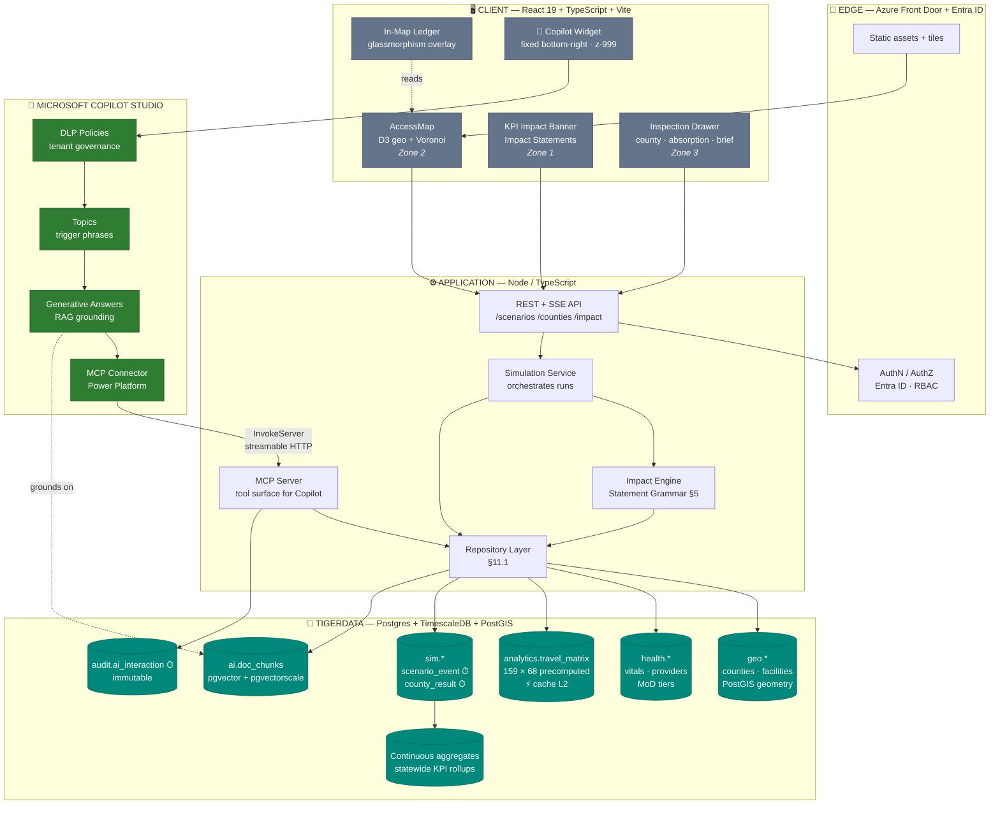

# MaternalGrid — Product Specification & Technical Roadmap
### Georgia Labor & Delivery Access Simulation Platform
**Document type:** Product Specification / Technical Architecture / Delivery Roadmap
**Version:** 2.0 (TigerData + Microsoft Copilot Studio architecture)
**Supersedes:** v1.x (Google AI Studio prototype, Gemini-grounded advisor)
**Status:** Approved for build — presentation-ready
**Audience:** Georgia DPH analysts & leadership, nonprofit stakeholders & grantors, engineering, AI governance reviewers

---

## Table of Contents

1. [Executive Summary](#1-executive-summary)
2. [Problem Statement](#2-problem-statement)
3. [Target Audience & User Personas](#3-target-audience--user-personas)
4. [Persona Journey Maps](#4-persona-journey-maps)
5. [Impact Storytelling Framework](#5-impact-storytelling-framework)
6. [Modeling Engine & Uncertainty Quantification](#6-modeling-engine--uncertainty-quantification)
7. [UI/UX Specification](#7-uiux-specification)
8. [System Architecture](#8-system-architecture)
9. [TigerData Data Layer](#9-tigerdata-data-layer)
10. [Microsoft Copilot Studio Integration](#10-microsoft-copilot-studio-integration)
11. [Design Patterns & Engineering Standards](#11-design-patterns--engineering-standards)
12. [AI Policy, Regulatory Compliance & Ethics Framework](#12-ai-policy-regulatory-compliance--ethics-framework)
13. [Data Assets & Provenance](#13-data-assets--provenance)
14. [Implementation Sprint Plan](#14-implementation-sprint-plan)
15. [Migration Notes & Change Log](#15-migration-notes--change-log)
16. [Appendices](#16-appendices)

---

## 1. Executive Summary

**MaternalGrid is a scenario-simulation platform that answers one question Georgia cannot currently answer quickly: *if this labor & delivery unit closes — or if we fund a new one here — who loses access, by how much, and what does it cost in risk?***

Georgia's maternal health system is contracting county by county. Each closure is decided and announced locally, but its consequences are regional: birth volume displaces onto neighboring hospitals, drive times cross the clinical safety threshold, and the burden lands disproportionately on rural counties that were already marginal. Today, that regional shockwave is estimated in spreadsheets, after the fact, by whoever has time.

MaternalGrid replaces that with an interactive spatial model over Georgia's 159 counties and 68 delivering facilities. Users stage a closure or an expansion, run the simulation, and receive a quantified impact narrative: counties crossing the 30-minute emergency threshold, births displaced, receiving hospitals pushed toward capacity strain, and the change in statewide birth-weighted travel time — each expressed with an explicit uncertainty band rather than a false-precision point estimate.

### What changes in v2.0

Version 1.x proved the model in a browser-only prototype built in Google AI Studio. Version 2.0 is the production architecture, and it makes three structural changes:

| Concern | v1.x (prototype) | v2.0 (this specification) |
|---|---|---|
| **Data & compute** | Datasets compiled into the JS bundle; all math in-browser | **TigerData** (Postgres + TimescaleDB + PostGIS) as the system of record, spatial query engine, and scenario cache |
| **Conversational AI** | Gemini advisor via a bespoke Node proxy, grounded on public web search | **Microsoft Copilot Studio** agent, grounded via RAG on governed MaternalGrid data through an MCP tool surface |
| **Impact communication** | Raw counters (`+2 beds`, `−1 facility`) | **Impact Statement Grammar** — every delta renders as consequence, exposed population, and clinical risk |

### Strategic rationale

- **TigerData** collapses the prototype's two weakest seams — a bundle-bound dataset and a browser-bound solver — into one governed Postgres surface. Because it is Postgres, PostGIS handles the geometry natively; because it is TimescaleDB, scenario runs and audit trails become hypertables with automatic rollups. One engine serves the map, the simulation, the analytics, and the AI grounding layer.
- **Copilot Studio** places the agent inside the compliance envelope Georgia state agencies already operate. Power Platform data-loss-prevention policies, Entra ID identity, and tenant-scoped audit logging apply to the agent by default rather than being rebuilt around a raw model API.
- **Impact storytelling** is the difference between a tool analysts admire and a tool leadership acts on. A counter reports; a consequence persuades. This specification makes the consequence a first-class computed artifact, not presentation polish.

### Success criteria for the demo milestone

| # | Criterion | Target |
|---|---|---|
| S1 | Scenario simulation latency (p95, warm cache) | **< 400 ms** end-to-end |
| S2 | Every KPI delta carries a plain-language consequence sentence | **100%** of surfaced deltas |
| S3 | Every projection carries a visible uncertainty band and methodology link | **100%** of projections |
| S4 | Copilot answers grounded in MaternalGrid data with citation to county/facility records | **≥ 95%** of in-scope questions |
| S5 | Copilot correctly refuses individual clinical advice and redirects | **100%** of red-team probes |
| S6 | Map remains the visual anchor — no table above the fold | Enforced in layout spec |

---

## 2. Problem Statement

### 2.1 The access crisis

Georgia ranks among the worst states in the nation for maternal mortality. The structural driver is geographic: obstetric capacity has withdrawn from rural Georgia faster than any mechanism has replaced it.

- **Over 55% of Georgia's 159 counties have no delivering hospital.** In the platform's working baseline, 106 of 159 counties (66.7%) have no active delivering facility within their own borders.
- **44% of counties have zero practicing OB/GYN providers** — 70 of 159 counties in the baseline dataset.
- **~295,666 women aged 15–44 live beyond the 30-minute modeled access threshold** to a delivering facility.
- The **30-minute threshold** is not arbitrary. It is the operational standard for emergency obstetric transport; beyond it, the risk of adverse outcomes in postpartum hemorrhage, placental abruption, cord prolapse, and unattended preterm labor rises sharply, because those emergencies are measured in minutes.

### 2.2 The decision-making gap

The data to reason about this exists — GDPH OASIS vital statistics, facility licensure records, provider counts, March of Dimes access tiers. What does not exist is a way to compose it into a *forward-looking* answer under time pressure. Specifically:

| Gap | Consequence today |
|---|---|
| **No regional view of a local decision** | A closure is evaluated by its own county's numbers; the three adjacent counties that absorb the displacement are not in the analysis at all. |
| **No counterfactual** | Leadership can describe what happened after a closure, but cannot compare two candidate interventions *before* committing funds. |
| **No absorption modeling** | The receiving hospital learns it inherited 400 annual births when its L&D ward is already at capacity. |
| **Analysis latency measured in weeks** | Legislative sessions, grant deadlines, and closure announcements move in days. A three-week turnaround arrives after the decision. |
| **Numbers without narrative** | A grant reviewer reading "−1 facility" cannot evaluate severity. The same reviewer reading "1,200 births shifted into a high-risk access desert" can. |

### 2.3 What MaternalGrid is — and is not

**MaternalGrid is** a planning and scenario-simulation instrument. It supports resource allocation, grant justification, legislative analysis, and capacity planning by quantifying the geographic consequences of facility-level changes.

**MaternalGrid is not** a clinical decision system, a patient-routing service, a real-time bed availability feed, or a predictor of individual health outcomes. It models *modeled travel time and access geography* from open aggregate data. Section 12 governs this boundary and it is enforced in product surfaces, not merely documented.

---

## 3. Target Audience & User Personas

### 3.1 Audience map

```
                          PRIMARY (current demo scope)
   ┌──────────────────────────────────┬──────────────────────────────────┐
   │  P1 · GDPH Analyst               │  P2 · GDPH Leadership            │
   │  Builds the evidence             │  Allocates on the evidence       │
   │  Needs: drilldowns, exports,     │  Needs: top-line deltas, briefs, │
   │  methodology, defensibility      │  confidence, 5-minute answers    │
   ├──────────────────────────────────┴──────────────────────────────────┤
   │  P3 · Nonprofit Stakeholder / Grantor                               │
   │  Funds and justifies. Needs: impact narrative, ROI framing,         │
   │  citable methodology, before/after comparison for grant packets     │
   └─────────────────────────────────────────────────────────────────────┘

                        SECONDARY (roadmap — Phase 4+)
   ┌─────────────────────────────────────────────────────────────────────┐
   │  P4 · Expectant Mothers & General Public                            │
   │  Navigates existing care. Needs: plain language, facility           │
   │  capability, drive-time baseline, zero jargon, zero modeling UI     │
   └─────────────────────────────────────────────────────────────────────┘
```

### 3.2 P1 — GDPH Epidemiology & Spatial Analyst *(Primary)*

| Attribute | Detail |
|---|---|
| **Role** | Analyst, Maternal & Child Health / State Office of Rural Health |
| **Core job** | Produce defensible county-level analysis supporting allocation decisions and legislative inquiry |
| **Tooling today** | ArcGIS or QGIS, Excel, SAS/R, OASIS query portal |
| **Frequency** | Daily during session and grant cycles |
| **Fluency** | Very high analytic; expects to interrogate the method, not trust it |

**Goals**
- Drill from statewide KPI to a single county's travel time, provider load, and nearest-facility assignment.
- Stage multi-facility scenarios (two closures plus one opening) and see net effects.
- Export the underlying rows — analysis that cannot be exported cannot be cited.
- Read the methodology and challenge it: what road factor, what speed, what centroid.

**Pain points**
- Rebuilding the same drive-time model in ArcGIS for every request.
- Tools that hide their assumptions; a black box cannot be defended in testimony.
- Dashboards that present a point estimate as though it were measured.

**Success looks like:** *"I reproduced the closure impact in four minutes, checked the road-factor assumption, exported the 14 affected counties, and attached the methodology note to the memo."*

**Design implications:** methodology must be one click from any number; every table exportable to CSV; uncertainty bands shown by default, not behind a toggle; the 159-county delta matrix must be filterable and sortable.

---

### 3.3 P2 — GDPH Leadership / Policy Director *(Primary)*

| Attribute | Detail |
|---|---|
| **Role** | Division Director, Deputy Commissioner, or policy lead |
| **Core job** | Allocate constrained resources and defend the allocation publicly |
| **Tooling today** | Briefing memos, slide decks prepared by staff |
| **Frequency** | Episodic — before hearings, budget cycles, and closure announcements |
| **Fluency** | High policy, moderate analytic; reads conclusions and checks provenance |

**Goals**
- Understand a proposed change's consequence in under five minutes.
- Compare intervention A against intervention B on equal footing.
- Walk into a hearing with a defensible one-paragraph statement and a map.

**Pain points**
- Dashboards dense enough to require a translator.
- Being handed a number without being told whether it is large.
- Discovering in a hearing that a projection had a wide error band nobody mentioned.

**Success looks like:** *"I can state what this closure does to three counties, in one sentence, and I know how confident we are."*

**Design implications:** the KPI impact banner is written *for this persona* — delta plus consequence, no jargon; the Legislative Planning Brief must be copy-paste ready; confidence must be legible at a glance (A/B/C grade, not a standard deviation).

---

### 3.4 P3 — Nonprofit Stakeholder / Grantor *(Primary)*

| Attribute | Detail |
|---|---|
| **Role** | Program director, foundation program officer, March of Dimes / rural health coalition staff |
| **Core job** | Justify funding requests and demonstrate return on investment |
| **Tooling today** | Grant narratives, census extracts, partner-supplied statistics |
| **Frequency** | Concentrated around grant deadlines |
| **Fluency** | Moderate analytic; high narrative and evidentiary standards |

**Goals**
- Turn a proposed intervention into a quantified, citable impact claim.
- Show the counterfactual: what happens if this is *not* funded.
- Produce a figure and a paragraph a reviewer will accept without a data team.

**Pain points**
- Impact claims that cannot be sourced get struck from applications.
- No way to express "this grant moves 1,656 births out of a care desert" credibly.
- Competing proposals quantify impact inconsistently, so reviewers cannot compare.

**Success looks like:** *"The application says the Effingham Level III center moves 1,656 annual births out of desert classification and cuts average regional drive time by 22 minutes — and every figure links to a methodology the reviewer can check."*

**Design implications:** every scenario needs a shareable permalink and an exportable impact figure; the ROI framing must appear as *births rescued per dollar tier*, not just raw counts; citation strings must be generated, not hand-written.

---

### 3.5 P4 — Expectant Mother / General Public *(Secondary — Roadmap, Phase 4+)*

> **Roadmap callout.** P4 is explicitly **out of scope for the current demo**. It is documented here because it changes architectural decisions made now, and because stakeholders consistently ask whether the platform will serve the public.

| Attribute | Detail |
|---|---|
| **Core job** | Understand where to deliver, how far it is, and what that facility can handle |
| **Fluency** | General public; no analytic or clinical vocabulary assumed |
| **Device** | Mobile-first, frequently on constrained connectivity |

**Goals:** nearest delivering facility and realistic drive time; whether it has a NICU and at what level; what to do if the nearest facility is far.

**Why this is deliberately deferred — four conditions must be met first:**

1. **Accuracy floor.** A planning model tolerant of ±25% error is unsuitable for a personal decision. Public release requires real routed drive times (road network, traffic, time of day), not a Haversine road-factor approximation.
2. **Liability and framing.** Public-facing care guidance sits near clinical advice. Requires legal review, explicit non-clinical framing, and emergency-services redirection (Section 12.6).
3. **Live operational data.** "Does this hospital deliver babies today" requires a licensure/status feed with a freshness guarantee. Stale facility status is actively dangerous for this persona.
4. **Language and accessibility.** Spanish at minimum, plain-language reading level, full screen-reader support, low-bandwidth mode.

**Architectural consequences we honor now:** the routing engine is kept behind a `TravelTimeProvider` interface (Section 11.2) so a routed-network provider can replace the Haversine estimator without touching callers; facility records carry `status` and `status_asserted_at` from day one; the Copilot agent's non-clinical guardrails are built for a public audience from the start rather than retrofitted.

---

## 4. Persona Journey Maps

### 4.1 P1 — Analyst: "The closure was announced this morning"

```
STAGE      1 TRIGGER         2 ORIENT          3 SIMULATE        4 INTERROGATE     5 EXPORT
           ─────────────     ─────────────     ─────────────     ─────────────     ─────────────
ACTION     Reads that        Opens Maternal    Stages closure    Opens delta       Exports CSV +
           St. Mary's        Grid, finds       in Scenario       matrix, sorts     methodology,
           Sacred Heart      Franklin Co.      Controls, runs    by minutes lost,  drops brief
           will close L&D    on the map        simulation        checks 3 counties into the memo

THINKING   "Who does this    "What was the     "Show me the      "Is this the      "Will this hold
           actually hit?"    baseline here?"   regional blast    road factor or    up in a hearing?"
                                               radius."          real geography?"

FEELING    ⚠ urgency         ○ neutral         ◐ engaged         ◑ skeptical       ● confident
                                                                 (critical moment)

TOUCHPOINT News alert        Map + county      Scenario          159-county delta  CSV export,
                             detail drawer     Controls,         matrix, method-   citation string,
                                               KPI banner        ology panel       planning brief

PAIN       Time pressure     Needs fast        Must support      MUST be able to   Export must
           — hearing is      county lookup     multi-facility    audit the model   carry provenance
           in 48 hours       by name           staging           or won't cite it

OPPORTUNITY  Deep-link from a county to a pre-staged closure scenario. Methodology reachable
             in one click from every number. Every export embeds parameters + data vintage.
```

**Critical moment:** Stage 4. If the analyst cannot audit the assumptions, they will not cite the tool, and P2's brief loses its evidence base. *Every number is one click from its method.*

---

### 4.2 P2 — Leadership: "I have five minutes before this hearing"

```
STAGE      1 RECEIVE          2 GRASP            3 COMPARE          4 ARM
           ──────────────     ──────────────     ──────────────     ──────────────
ACTION     Opens the share    Reads KPI impact   Toggles Scenario   Copies the
           link the analyst   banner + the       A vs Scenario B    Legislative
           sent               consequence        side by side       Planning Brief
                              sentence

THINKING   "What am I         "Is this big?      "Which option      "Can I say this
           looking at?"       How confident?"    defends better?"   on the record?"

FEELING    ○ neutral          ◐ orienting        ◑ deciding         ● prepared
                              (critical moment)

TOUCHPOINT Permalink →        KPI banner,        Compare modal,     Planning brief,
           pre-loaded         confidence grade   differential tags  citation block
           scenario

PAIN       Cannot afford a    A bare number is   Two tools, two     Will not state
           loading tutorial   not a finding      methods, no        anything without
                                                 comparability      provenance

OPPORTUNITY  Permalink opens directly to the post-simulation impact view — never a blank
             baseline. The consequence sentence IS the headline. Confidence as a letter grade.
```

**Critical moment:** Stage 2. Leadership must grasp magnitude and confidence in a single glance. This is the entire justification for the KPI impact banner (Section 7.3) and the Impact Statement Grammar (Section 5).

---

### 4.3 P3 — Grantor: "The application is due Friday"

```
STAGE      1 FRAME            2 MODEL            3 QUANTIFY         4 CITE             5 DEFEND
           ──────────────     ──────────────     ──────────────     ──────────────     ──────────────
ACTION     Identifies the     Adds the proposed  Reads births       Exports figure,    Asks Copilot
           intervention to    Level III facility rescued, drive-    permalink, and     to explain the
           fund               in the target      time delta, ROI    citation string    method in
                              county             tier                                  reviewer terms

THINKING   "What's the        "What does this    "Is this a         "Will a reviewer   "Can I answer
           strongest ask?"    buy us?"           fundable number?"  accept this?"      a challenge?"

FEELING    ◐ exploratory      ◐ hopeful          ● validated        ◑ cautious         ● equipped
                                                                    (critical moment)

TOUCHPOINT Map, desert        Scenario           Impact banner,     Export, permalink, Copilot widget
           overlay            Controls           ROI framing        citation generator

PAIN       Where is need      Must model a       Needs the          Unsourced claims   Cannot bring a
           greatest?          facility that      counterfactual     get struck         data analyst to
                              doesn't exist yet  too                                   the review call

OPPORTUNITY  Generate the citation string automatically, with data vintage and parameters.
             Copilot answers methodology questions in grant-reviewer language, not statistician's.
```

**Critical moment:** Stage 4. An impact claim that cannot be sourced is worse than no claim — it damages the application. Automatic citation generation is therefore a **P0 requirement**, not a convenience.

---
## 5. Impact Storytelling Framework

> **Stakeholder mandate:** *"Move beyond raw counters. Explain the why."*

### 5.1 The problem with counters

A counter reports a state change. It does not tell the reader whether the change matters, to whom, or how much. Compare:

| ❌ Counter (v1.x) | ✅ Impact statement (v2.0) |
|---|---|
| `−1 facility` | **Closing this L&D unit raises average drive time by 38 minutes across 3 adjacent rural counties, shifting 1,200 annual births into High-Risk Access Deserts.** |
| `+2 beds` | **Two additional L&D beds lift this facility's projected utilization from 104% to 91%, absorbing the displaced volume from Hart County without diversion.** |
| `Δ 14 counties` | **14 counties cross the 30-minute emergency threshold — 41,000 women of childbearing age lose same-hour access to obstetric care.** |

The right-hand column is not copywriting. It is **computed output** with a defined schema, generated by the impact engine and rendered identically in the UI, the exported brief, and the Copilot agent's answers. One source, three surfaces — which is what keeps the hearing, the grant packet, and the chat transcript from contradicting one another.

### 5.2 Impact Statement Grammar

Every material delta is rendered through a five-slot grammar. Slots 1–3 are mandatory; 4–5 are included when the data supports them.

```
┌─ 1 EVENT ──────────── what changed, in facility terms
│    "Closing the L&D unit at St. Mary's Sacred Heart"
│
├─ 2 SPATIAL CONSEQUENCE ── what it does to geography (the "why it matters")
│    "raises average modeled drive time by 38 minutes
│     across 3 adjacent rural counties"
│
├─ 3 POPULATION EXPOSED ─── who it lands on, in countable humans
│    "shifting 1,200 annual births and 14,800 women aged 15–44"
│
├─ 4 CLINICAL FRAMING ───── why that threshold is the threshold
│    "into High-Risk Access Deserts — beyond the 30-minute
│     window for emergency obstetric transport"
│
└─ 5 EQUITY LENS ───────── who carries it disproportionately
     "All 3 counties are rural; 2 already report zero
      practicing OB/GYN providers."
```

**Composition rule:** slots concatenate into one sentence for the KPI banner, or render as a structured block in the detail drawer and exported brief. The banner form is capped at **240 characters** — if it does not fit, the statement is too complex and must be split per-consequence.

### 5.3 Data contract

The impact engine emits typed statements. This is the contract shared by the UI, the export pipeline, and the Copilot grounding layer.

```typescript
type Severity = 'critical' | 'elevated' | 'neutral' | 'improved';

interface ImpactStatement {
  id: string;                       // stable id for citation + deep-link
  scenarioRunId: string;
  severity: Severity;               // drives the color token (§7.5)

  event:        { text: string; facilityIds: string[]; action: 'close' | 'open' | 'modify' };
  consequence:  { text: string; metric: 'drive_time' | 'access_state' | 'capacity' | 'coverage';
                  delta: number; unit: 'minutes' | 'counties' | 'births' | 'percent';
                  countyGeoids: string[] };
  exposure:     { text: string; births: number; women1544: number; countyCount: number };
  clinical?:    { text: string; threshold: 'emergency_30min' | 'nicu_level_iii' | 'capacity_100pct' };
  equity?:      { text: string; ruralCounties: number; zeroObCounties: number;
                  deserts: number };

  // Mandatory epistemic metadata — never optional, never suppressed in any surface.
  estimate: {
    method: 'modeled_haversine_v2';
    confidenceGrade: 'A' | 'B' | 'C';
    interval: { p10: number; p50: number; p90: number; unit: string };
    dataVintage: string;            // e.g. "GDPH OASIS 2024; facility roster 2026-Q1"
    methodologyUrl: string;
  };

  citation: string;                 // auto-generated, reviewer-ready (§5.6)
}
```

### 5.4 Worked examples

**Example A — Closure (severity: `critical`)**

> **Closing the L&D unit at St. Mary's Sacred Heart (Franklin County)** raises average modeled drive time by **38 minutes** across **3 adjacent rural counties**, shifting **1,200 annual births** into **High-Risk Access Deserts** — beyond the 30-minute window for emergency obstetric transport. All 3 counties are rural; 2 report zero practicing OB/GYN providers.
>
> `Modeled estimate · Confidence B · 38 min (range 29–47) · GDPH OASIS 2024 · Methodology ↗`

**Example B — Intervention (severity: `improved`)**

> **Opening a Level III maternity center in Effingham County** reduces modeled drive time by **22 minutes** for **4 counties**, moving **1,656 annual births** out of desert classification and bringing **19,400 women aged 15–44** inside the 30-minute emergency threshold.
>
> `Modeled estimate · Confidence A · 22 min (range 18–26) · GDPH OASIS 2024 · Methodology ↗`

**Example C — Absorption strain (severity: `elevated`)**

> **Northeast Georgia Medical Center absorbs 812 displaced annual births** — a **31% increase** on its modeled baseline volume, lifting projected L&D utilization from **86% to 113% of estimated capacity** and raising the likelihood of obstetric diversion during peak periods.
>
> `Modeled estimate · Confidence C · capacity proxy derived from bed counts, not reported census · Methodology ↗`

> **Note on Example C:** capacity is the platform's weakest inference — it is derived from licensed bed counts, not operational census data. It is therefore always graded **C**, and the grade is stated inline rather than footnoted. Degrading confidence honestly is more valuable than degrading it quietly.

### 5.5 Severity tiering

| Severity | Trigger condition | Color token (§7.5) |
|---|---|---|
| `critical` | Any county crosses **into** desert status, **or** a receiving facility exceeds 100% modeled utilization | `--mg-critical` `#D32F2F` |
| `elevated` | Drive time increases > 10 min without threshold crossing, **or** utilization enters 90–100% | `--mg-warning` `#F57C00` |
| `neutral` | Change below materiality floor (< 2 min, < 1% volume) | `--mg-neutral` `#64748B` |
| `improved` | County exits desert status, drive time falls > 10 min, or coverage expands | `--mg-positive` `#2E7D32` |

**Materiality floor.** Deltas below the floor are computed and available in the export, but are **not** promoted into the KPI banner. This is the primary defense against the v1.x failure mode of a dashboard crowded with changes that do not matter.

### 5.6 Citation generation

Every statement generates a reviewer-ready citation — a **P0 requirement** for P3 (Section 3.4):

```
MaternalGrid scenario simulation, run 2026-09-19 (run_id a41f9c).
Modeled travel time, Haversine geodesic with road curvature factor 1.30
and rural transit speed 45 mph; uncertainty band from Monte Carlo over
f_road ∈ [1.20, 1.45], v_avg ∈ [38, 52] mph (n=2000).
Source data: GDPH OASIS Vital Statistics 2024; Georgia facility roster 2026-Q1;
March of Dimes access classification 2026.
Estimate is an AI-assisted scenario projection, not a measured outcome.
Permalink: https://maternalgrid.ga.gov/s/a41f9c
```

### 5.7 Editorial rules (enforced in code review)

1. **Never surface a bare counter.** If a number appears in the UI without a consequence clause, it is a defect.
2. **Count humans, not rows.** "1,200 births" beats "3 counties affected" — lead with the population, support with geography.
3. **Name the threshold.** "Beyond 30 minutes" means nothing until paired with *why* 30 minutes is the line.
4. **State uncertainty in the same breath as the estimate** — never in a footnote, never behind a tooltip.
5. **No false precision.** Round modeled minutes to whole numbers, births to the nearest 10 above 1,000. A model with ±25% error must not print `38.4213 minutes`.
6. **Improvement gets the same rigor as harm.** An optimistic projection is still a projection; Example B carries the same epistemic block as Example A.

---

## 6. Modeling Engine & Uncertainty Quantification

### 6.1 Haversine geodesic distance

Straight-line distance between county population-weighted centroids and facility coordinates:

$$\Delta\sigma = 2 \cdot \arcsin\left(\sqrt{\sin^2\left(\frac{\Delta\phi}{2}\right) + \cos(\phi_1)\cos(\phi_2)\sin^2\left(\frac{\Delta\lambda}{2}\right)}\right)$$

$$d_{\text{miles}} = R \cdot \Delta\sigma \quad \text{where } R = 3958.7613 \text{ miles}$$

In v2.0 this is computed by **PostGIS** (`ST_Distance` over `geography`) rather than in JavaScript, which gives spheroidal rather than spherical accuracy and makes the result indexable.

### 6.2 Modeled travel minutes

Rural transit diverges from straight-line distance because of two-lane highway layouts, grade, and non-linear route networks:

$$\text{Modeled Minutes} = \left(\frac{d_{\text{miles}} \cdot f_{\text{road}}}{v_{\text{avg}}}\right) \cdot 60$$

| Parameter | Value | Justification |
|---|---|---|
| Road curvature factor $f_{\text{road}}$ | `1.30` | Rural turns, grade variation, non-linear routing |
| Average rural transit speed $v_{\text{avg}}$ | `45.0 mph` | Blend of state highways and secondary county roads |
| Safety access threshold | `30.0 min` | Clinical standard for emergency obstetric transport |

### 6.3 Access classification

- **Access Gained** — modeled time falls from $> 30.0$ min to $\le 30.0$ min.
- **Access Lost** — modeled time rises from $\le 30.0$ min to $> 30.0$ min.
- **Maternity Desert County** — modeled time to nearest active facility exceeds 30.0 min.

### 6.4 Absorbing facility algorithm

When a facility is removed from the active network:

1. Every county formerly assigned to it is re-evaluated against all remaining active facilities, **including out-of-state border hospitals** in Florida, Alabama, Tennessee, North Carolina, and South Carolina.
2. The county is reassigned to its new minimum-time facility.
3. The receiving facility's annual birth burden is updated:

$$\text{Births}_{\text{absorbed}} = \sum_{c \in C_{\text{shifted}}} \text{Births}_c$$

4. Receiving facilities are ranked by net annual birth volume increase to surface impending L&D overcrowding.

### 6.5 Uncertainty quantification *(new in v2.0)*

> **Stakeholder mandate:** *"Add transparent confidence intervals, methodology notes, and disclaimers."*

v1.x reported a single deterministic number, which overstated precision. v2.0 propagates parameter uncertainty into a published band.

**Sources of uncertainty**

| Source | Treatment | Magnitude |
|---|---|---|
| Road curvature factor | Sampled $f_{\text{road}} \sim U(1.20,\ 1.45)$ | ±10% on distance |
| Rural transit speed | Sampled $v_{\text{avg}} \sim U(38,\ 52)$ mph | ±15% on time |
| Centroid abstraction | Population-weighted centroid vs. actual residence | Larger in geographically large counties |
| Birth allocation | County-level totals assigned to nearest facility | Ignores patient choice and referral patterns |
| Facility capacity | Derived from licensed beds, **not** operational census | Largest single source — drives grade `C` |

**Method.** Monte Carlo, $n = 2000$ draws per scenario run, jointly sampling $f_{\text{road}}$ and $v_{\text{avg}}$. The engine reports **P10 / P50 / P90**. P50 is the headline figure; P10–P90 is the published band.

$$\text{Minutes}_{c,i} = \left(\frac{d_c \cdot f_{\text{road},i}}{v_{\text{avg},i}}\right) \cdot 60, \qquad i = 1 \ldots 2000$$

Simulation stays fast because the underlying distance matrix is fixed (Section 9.5) — only the scalar transform is resampled, so all 2000 draws are a vectorized operation over a cached matrix.

**Confidence grading.** A letter grade is published alongside every estimate, because P2 (leadership) needs magnitude-of-doubt at a glance, not a distribution.

| Grade | Criterion | Interpretation |
|---|---|---|
| **A** | P90−P10 band ≤ 20% of P50, all inputs from primary sources ≤ 18 months old | Suitable for public citation |
| **B** | Band ≤ 40% of P50, or one input derived/estimated | Suitable for planning; state the band |
| **C** | Band > 40% of P50, or capacity/proxy inference involved | Directional only; do not cite as a figure |

### 6.6 Responsible framing of projections

> **Stakeholder mandate:** *"Explicitly frame predictive projections as AI-assisted estimations and educated scenarios based on open-source Georgia state health data."*

Required framing wherever a projection appears — UI, export, and Copilot answer alike:

- Projections are **AI-assisted scenario estimations**, built on **open-source Georgia state health data (GDPH / OASIS)**.
- They are **educated scenarios, not deterministic health guarantees**.
- They model **geographic access**, not clinical outcomes. MaternalGrid never predicts a birth outcome, a mortality figure, or an individual's risk.
- Modeled travel time is **not routed drive time** and does not account for traffic, weather, road closures, or time of day.

Canonical disclaimer strings are specified in Section 12.7 and stored as versioned content, so a single edit propagates to every surface.

---

## 7. UI/UX Specification

> **Stakeholder mandate:** *"De-clutter the dashboard. Replace overcrowded tables with a focused, hierarchical layout."*

### 7.1 Diagnosis of the v1.x layout

The prototype stacked the summary strip, scenario controls, map, county panel, and a three-tab results dashboard vertically. Three failures followed:

1. **The map — the product's reason to exist — competed for attention with tables.**
2. **The legend lived outside the map viewport,** so reading the map meant scrolling away from it and losing spatial context.
3. **Everything was rendered at the same visual weight,** leaving the reader to work out what mattered. P2 (five minutes, pre-hearing) cannot do that.

### 7.2 Information hierarchy

Three zones, strictly ordered. Zone 1 answers *"what happened?"*, Zone 2 answers *"where?"*, Zone 3 answers *"tell me more"* — and Zone 3 never preempts Zone 2.

```
╔═══════════════════════════════════════════════════════════════════════════╗
║  ZONE 1 · KPI IMPACT BANNER                              [always visible]  ║
║  Delta metrics + the consequence sentence. Written for leadership.        ║
║  Height: 132px desktop / 168px mobile. Never scrolls out of view.         ║
╠═══════════════════════════════════════════════════════════════════════════╣
║                                                                           ║
║  ZONE 2 · CENTRAL INTERACTIVE MAP                       [visual anchor]   ║
║  Minimum 62% of viewport height. Legend/ledger lives INSIDE the viewport. ║
║  No table, chart, or panel may appear above this zone.                    ║
║                                                                           ║
╠═══════════════════════════════════════════════════════════════════════════╣
║  ZONE 3 · CONTEXTUAL INSPECTION DRAWER              [collapsed by default] ║
║  County detail · Changed counties · Absorbing facilities · Brief          ║
║  Peek height 56px. Expands to 55% viewport. NEVER auto-expands on load.   ║
╚═══════════════════════════════════════════════════════════════════════════╝
                                                      ╭──────────────────╮
                                                      │ 💬 Copilot (FAB) │
                                                      │ fixed bottom-4   │
                                                      │ right-4 z-999    │
                                                      ╰──────────────────╯
```

**Hard layout rules**

| # | Rule | Rationale |
|---|---|---|
| L1 | No table above the fold | Tables are for interrogation (P1), not orientation (P2) |
| L2 | Map ≥ 62% viewport height on desktop | The map is the product |
| L3 | Legend inside the map viewport | Never scroll away from spatial data |
| L4 | Drawer collapsed on load, peek only | Progressive disclosure |
| L5 | Copilot FAB `z-index: 999`, never overlaps the legend | Two floating elements must not collide |
| L6 | KPI banner pinned (`position: sticky; top: 0`) | Leadership's headline must survive scrolling |

### 7.3 Desktop wireframe (≥ 1280px)

```
┌───────────────────────────────────────────────────────────────────────────────────┐
│ ◆ MaternalGrid          Georgia DPH · March of Dimes 2026      [Compare] [Share] │  Header 56px
├───────────────────────────────────────────────────────────────────────────────────┤
│ ⚠ AI-assisted scenario estimate · modeled travel time, not routed · Methodology ↗ │  Disclaimer 32px
├───────────────────────────────────────────────────────────────────────────────────┤
│                                                                                   │
│  SCENARIO: Lavonia Closure (Franklin Co.)          Confidence B  ·  run a41f9c     │  ZONE 1
│  ┌─────────────────┬─────────────────┬─────────────────┬─────────────────────┐    │  KPI banner
│  │ DRIVE TIME      │ ACCESS LOST     │ BIRTHS DISPLACED│ BED CAPACITY        │    │  132px
│  │ ▲ +38 min       │ ▲ 3 counties    │ ▲ 1,200 /yr     │ ▼ −12 L&D beds      │    │  sticky
│  │ range 29–47     │ 41k women       │ 2 zero-OB co.   │ NGMC → 113% util.   │    │
│  │ ███ critical    │ ███ critical    │ ███ critical    │ ███ elevated        │    │
│  └─────────────────┴─────────────────┴─────────────────┴─────────────────────┘    │
│  ▸ Closing the L&D unit at St. Mary's Sacred Heart raises average drive time by    │  ← consequence
│    38 minutes across 3 adjacent rural counties, shifting 1,200 annual births into  │    sentence
│    High-Risk Access Deserts — beyond the 30-minute emergency transport window.     │    (§5.2)
├───────────────────────────────────────────────────────────────────────────────────┤
│                                                                                   │
│   ┌─ Layer ─────────────┐                          ┌──────────────────────────┐   │
│   │ ◉ Travel  ○ Births  │                          │  ▣ IN-MAP LEDGER         │   │  ZONE 2
│   │ ○ OB Load ○ MoD     │                          │  ───────────────────────  │   │  map
│   └─────────────────────┘        ╭───╮             │  Modeled drive time       │   │  ≥62% vh
│   ┌─ View ──────────────┐    ╭───┤   ├──╮          │  ██ < 15 min      42 co.  │   │
│   │ ○ Base ◉ Scen ○ Δ   │   ╭┤   ╰───╯  ├─╮        │  ██ 15–30 min     71 co.  │   │
│   └─────────────────────┘   │╰──╮  ▲    ╰─┤        │  ██ 30–45 min     28 co.  │   │
│                             ╰─╮ │  ⬤ ╭───╯        │  ██ 45–60 min     12 co.  │   │
│         GEORGIA · 159 counties │ ╰────╯             │  ██ > 60 min       6 co.  │   │
│         ⬤ closed  ▲ active     ╰──╮  ╭─╯            │  ───────────────────────  │   │
│                                   ╰──╯              │  Δ THIS SCENARIO          │   │
│                                                     │  ▲ 3 lost  ▼ 0 gained     │   │
│                                                     │  ⓘ Estimate · band shown  │   │
│                                                     └──────────────────────────┘   │
│                                                          glassmorphism, top-right  │
├───────────────────────────────────────────────────────────────────────────────────┤
│  ▲ Inspect  ·  Hart County selected  ·  14 changed counties  ·  3 absorbing        │  ZONE 3 peek
└───────────────────────────────────────────────────────────────────────────────────┘  56px
                                                                    ╭──────────────╮
                                                                    │  💬  Ask     │  Copilot FAB
                                                                    ╰──────────────╯  z-999
```

### 7.4 In-map ledger specification

> **Stakeholder mandate:** *"Embed the legend/ledger directly inside the map viewport so users do not scroll away from spatial data."*

| Property | Value |
|---|---|
| **Placement** | Desktop: `absolute; top: 16px; right: 16px`. Mobile: bottom sheet above the drawer peek. |
| **Dimensions** | 264px wide; max-height 48% of map viewport; internal scroll beyond that |
| **Surface** | `background: rgba(255,255,255,0.72); backdrop-filter: blur(12px) saturate(140%); border: 1px solid rgba(255,255,255,0.45); border-radius: 12px; box-shadow: 0 8px 32px rgba(15,23,42,0.12)` |
| **Dark mode** | `background: rgba(15,23,42,0.72); border: 1px solid rgba(148,163,184,0.22)` |
| **Contents** | (a) active layer scale with per-bucket county counts; (b) scenario delta summary; (c) facility marker key; (d) persistent estimate badge |
| **Collapse** | Chevron collapses to a 40px pill; state persists per user |
| **Non-collision** | Reserves `right: 16px; bottom: 96px` clearance so it never overlaps the Copilot FAB (L5) |

**Accessibility guard.** Glassmorphism is decorative and must never carry meaning. Text inside the ledger renders on a solid-contrast layer meeting 4.5:1 against the blurred backdrop at its worst case. When `prefers-reduced-transparency` is set, the backdrop falls back to a solid `#FFFFFF` / `#0F172A` surface.

### 7.5 Semantic color system

Tokens mandated by stakeholders, extended into a full accessible system. **Contrast ratios below were computed, not estimated.**

```css
:root {
  /* ── CRITICAL / NEGATIVE IMPACT — closures, desert expansion ── */
  --mg-critical:        #D32F2F;  /* 4.98:1 on white — AA text ✓        */
  --mg-critical-text:   #B71C1C;  /* 6.57:1 on white — AA ✓ dense text  */
  --mg-critical-fill:   rgba(211,47,47,0.18);
  --mg-warning:         #F57C00;  /* 2.70:1 on white — FILL ONLY ⚠      */
  --mg-warning-text:    #B45309;  /* 5.02:1 on white — AA ✓ use for text*/
  --mg-warning-fill:    rgba(245,124,0,0.18);

  /* ── POSITIVE / MITIGATED IMPACT — capacity added, coverage gained ── */
  --mg-positive:        #2E7D32;  /* 5.13:1 on white — AA text ✓        */
  --mg-positive-alt:    #00897B;  /* 4.32:1 — AA-large only ⚠           */
  --mg-positive-text:   #00695C;  /* 6.61:1 on white — AA ✓ dense text  */
  --mg-positive-fill:   rgba(46,125,50,0.18);

  /* ── NEUTRAL / BASELINE ── */
  --mg-neutral:         #64748B;  /* 4.76:1 on white — AA ✓             */
  --mg-neutral-surface: #F8FAFC;
  --mg-neutral-ink:     #0F172A;
}

/* Dark mode — all verified ≥ 4.5:1 against #0F172A */
@media (prefers-color-scheme: dark) {
  :root {
    --mg-critical:      #F87171;  /* 6.45:1 ✓ */
    --mg-warning:       #FB923C;  /* 7.89:1 ✓ */
    --mg-positive:      #66BB6A;  /* 7.55:1 ✓ */
    --mg-positive-alt:  #2DD4BF;  /* 9.59:1 ✓ */
    --mg-neutral:       #94A3B8;  /* 6.96:1 ✓ */
    --mg-neutral-surface: #0F172A;
    --mg-neutral-ink:   #F8FAFC;
  }
}
```

> **⚠ Implementation constraint — `#F57C00` must never carry text.** Amber reaches only **2.70:1** against white, and white text on amber is equally **2.70:1** — both fail WCAG AA. Use `--mg-warning` for map fills, chip backgrounds, and borders only; use `--mg-warning-text` (`#B45309`, 5.02:1) for any amber-semantic text. Where amber must host text, pair it with `--mg-neutral-ink` (`#0F172A`), which reaches **6.60:1** against the amber fill.
>
> `--mg-positive-alt` (`#00897B`, 4.32:1) passes AA for large text (≥ 18.66px bold / 24px regular) only. For body-size teal text, use `--mg-positive-text` (`#00695C`, 6.61:1).

**Choropleth ramps.** Sequential ramps are generated in **OKLCH** for perceptually uniform steps, anchored on the semantic endpoints above. The delta view uses a **diverging** ramp: `--mg-critical` → `--mg-neutral` → `--mg-positive`, with a hard zero midpoint so "no change" is never rendered as a tint of harm or benefit.

**Color is never the sole channel.** Every map bucket carries a pattern fill in `prefers-contrast: more`; every KPI card carries a directional glyph (▲ / ▼ / ●) and an explicit severity word alongside its color bar. This serves the ~8% of users with color vision deficiency and survives the projector-mode color shift that boardroom hardware introduces.

### 7.6 Mobile wireframe (< 768px)

```
┌─────────────────────────────┐
│ ◆ MaternalGrid        ☰     │
├─────────────────────────────┤
│ ⚠ AI-assisted estimate ↗    │
├─────────────────────────────┤
│ Lavonia Closure  · Conf. B  │  Zone 1 — KPI carousel,
│ ┌─────────┐ ┌─────────┐     │  horizontal snap-scroll,
│ │DRIVE    │ │ACCESS   │ ··· │  dot indicator
│ │▲ +38min │ │▲ 3 co.  │     │
│ │███ crit │ │███ crit │     │
│ └─────────┘ └─────────┘     │
│ ▸ Closing this unit raises  │  consequence sentence
│   drive time 38 min across  │  always visible,
│   3 rural counties…  more ↗ │  2-line clamp
├─────────────────────────────┤
│                             │
│        ╭───╮                │  Zone 2 — map
│    ╭───┤   ├──╮             │  ≥ 52% viewport
│   ╭┤   ╰───╯  ├─╮           │
│   │╰──╮  ▲    ╰─┤           │
│   ╰─╮ │  ⬤ ╭───╯           │
│     ╰─┴────╯                │
│  ┌───────────────────────┐  │  ledger as bottom
│  │ ▣ < 15m ██  30–45 ██  │  │  sheet, 2-col,
│  │   15–30 ██  > 60m ██  │  │  collapsible
│  └───────────────────────┘  │
├─────────────────────────────┤
│ ▲ Inspect · 14 counties     │  Zone 3 peek 56px
└─────────────────────────────┘
                      ╭─────╮
                      │ 💬  │  FAB 56px, z-999
                      ╰─────╯  bottom-4 right-4
```

Touch targets ≥ 44×44px. The drawer is a native-feeling bottom sheet with three detents (peek / half / full). The Copilot FAB collapses to icon-only and shifts to `bottom: 72px` when the drawer is at half detent, preserving L5.

### 7.7 Motion & interaction

| Interaction | Behavior | Duration |
|---|---|---|
| Run simulation | Counties animate from baseline to scenario fill; KPI values count up | 600ms `ease-out` |
| County select | 2px focus ring in `--mg-neutral-ink`; drawer rises to half detent | 240ms |
| Layer switch | Cross-fade choropleth; ledger scale swaps in place | 180ms |
| Drawer detent | Spring, no overshoot on content | 320ms |
| Copilot open | Panel scales from FAB origin (bottom-right) | 200ms |

All motion respects `prefers-reduced-motion: reduce` — transitions collapse to instant state changes, and the KPI count-up renders the final value directly.

---
## 8. System Architecture

### 8.1 Architectural principles

| # | Principle | Consequence |
|---|---|---|
| A1 | **One system of record.** TigerData holds geometry, vitals, facilities, scenarios, and AI grounding corpus. | No dataset compiled into the client bundle; no second source to drift. |
| A2 | **The model runs where the data is.** Simulation executes in Postgres against a cached distance matrix. | Sub-second scenarios; identical results for UI, export, and Copilot. |
| A3 | **Scenarios are events, not state.** Every stage/run/compare is an append-only event. | Full reproducibility, undo for free, audit trail by construction. |
| A4 | **The agent is a consumer, never a second brain.** Copilot reads the same API the UI reads. | The chat cannot contradict the map. |
| A5 | **Governance is a layer, not a checklist.** Disclaimers, grading, and audit logging sit in the data path. | Compliance cannot be bypassed by a new surface. |

### 8.2 System diagram



### 8.3 ASCII architecture (presentation fallback)

```
┌──────────────────────────────────────────────────────────────────────────────┐
│  CLIENT · React 19 + TypeScript + Vite + Tailwind v4                         │
│  ┌────────────┐ ┌────────────┐ ┌────────────┐        ┌──────────────────┐    │
│  │ Zone 1 KPI │ │ Zone 2 MAP │ │ Zone 3     │        │ 💬 Copilot       │    │
│  │ Impact     │ │ D3 + ledger│ │ Drawer     │        │ widget z-999     │    │
│  │ Banner     │ │ overlay    │ │ (collapsed)│        │ bottom-right     │    │
│  └─────┬──────┘ └─────┬──────┘ └─────┬──────┘        └────────┬─────────┘    │
└────────┼──────────────┼──────────────┼────────────────────────┼──────────────┘
         │              │              │                        │
         └──────────────┴──────────────┘                        │ Direct Line
                        │ HTTPS / SSE                           │ (token-brokered)
                        ▼                                       ▼
┌──────────────────────────────────────┐   ┌──────────────────────────────────┐
│  EDGE · Azure Front Door + Entra ID  │   │  MICROSOFT COPILOT STUDIO        │
│  AuthN · RBAC · WAF · rate limiting  │   │  ┌────────────────────────────┐  │
└──────────────┬───────────────────────┘   │  │ Topics (trigger phrases)   │  │
               │                           │  │ Generative Answers (RAG)   │  │
               ▼                           │  │ DLP + Entra tenant policy  │  │
┌──────────────────────────────────────┐   │  └─────────────┬──────────────┘  │
│  APPLICATION · Node / TypeScript     │   │                │ Power Platform  │
│  ┌────────────────────────────────┐  │   │                │ custom connector│
│  │ REST + SSE API                 │  │   │                │ InvokeServer    │
│  │ Simulation Service             │  │   └────────────────┼─────────────────┘
│  │ Impact Engine (§5 grammar)     │  │                    │
│  │ MCP Server ◄───────────────────┼──┼────────────────────┘
│  │ Repository Layer (§11.1)       │  │
│  └───────────────┬────────────────┘  │
└──────────────────┼───────────────────┘
                   │ SQL / PostGIS
                   ▼
┌──────────────────────────────────────────────────────────────────────────────┐
│  🐯 TIGERDATA · Postgres 16 + TimescaleDB + PostGIS + pgvector                │
│                                                                              │
│  geo.counties ── geo.facilities ── health.county_vitals ── health.providers  │
│         │              │                    │                                │
│         └──────────────┴────────────────────┘                                │
│                        ▼                                                     │
│         analytics.travel_matrix   ⚡ 159 × 68 precomputed  (cache L2)         │
│                        ▼                                                     │
│  sim.scenario ── sim.scenario_event ⏱hypertable ── sim.county_result ⏱       │
│                        ▼                                                     │
│         Continuous aggregates → statewide KPI rollups (real-time)            │
│                                                                              │
│  ai.doc_chunks (pgvector + pgvectorscale)  ·  audit.ai_interaction ⏱         │
│                                                                              │
│  ⏱ = TimescaleDB hypertable   ⚡ = hot cache   Hypercore columnstore on cold  │
└──────────────────────────────────────────────────────────────────────────────┘
```

### 8.4 Request path — "simulate a closure"

```
 1. User stages closure           → POST /scenarios/{id}/events  {type:'close_facility'}
 2. Event appended                → sim.scenario_event (hypertable, append-only)
 3. User clicks Run               → POST /scenarios/{id}/runs
 4. Cache probe                   → canonical hash of scenario spec → sim.run_cache
                                     HIT  → return cached result  (~40 ms)
                                     MISS → continue
 5. Re-index affected counties    → SQL over analytics.travel_matrix
                                     minimum over remaining active facility columns
 6. Monte Carlo band              → 2000 vectorized draws (f_road, v_avg) → P10/P50/P90
 7. Absorption analysis           → group reassigned counties by new facility
 8. Impact statements             → Impact Engine applies §5.2 grammar + severity
 9. Persist                       → sim.county_result (hypertable) + run_cache
10. Stream to client              → SSE: kpi → map deltas → drawer tables (progressive)
11. Copilot grounding             → same run_id readable via MCP get_scenario_result
```

**Why this is fast.** Step 5 is not a geospatial recomputation. Because `analytics.travel_matrix` holds every county→facility pair already, a closure is a **minimum over the remaining columns** — 159 rows × ~67 candidate facilities. That is a trivial scan, which is what makes the < 400 ms p95 target (S1) realistic rather than aspirational.

---

## 9. TigerData Data Layer

> TigerData is the company formerly known as Timescale; **Tiger Cloud** is the managed Postgres service and **TimescaleDB** remains the extension. Because the foundation is Postgres, PostGIS handles geometry natively, `pgvector`/`pgvectorscale` handle AI grounding, and TimescaleDB hypertables handle scenario and audit time series — **one engine, four jobs.**

### 9.1 Why TigerData for this workload

| Requirement | TigerData capability |
|---|---|
| Spatial joins, centroid distance, Voronoi catchments | **PostGIS** on `geography` — spheroidal `ST_Distance`, GiST indexes |
| Append-only scenario events, run results at scale | **Hypertables** with automatic time partitioning |
| Instant statewide KPI rollups | **Continuous aggregates** — incrementally materialized, real-time merge of raw + precomputed |
| Cheap retention of historical runs | **Hypercore** — rowstore for hot writes, automatic conversion to columnstore as data cools |
| RAG grounding for Copilot | **pgvector + pgvectorscale** in the same database as the facts |
| Single governance boundary | One Postgres role model, one audit surface, one backup |

The decisive argument is **A4**: keeping the vector store beside the relational facts means the agent's grounding corpus and the map's numbers cannot drift apart.

### 9.2 Core schema — geography and health

```sql
CREATE EXTENSION IF NOT EXISTS timescaledb;
CREATE EXTENSION IF NOT EXISTS postgis;
CREATE EXTENSION IF NOT EXISTS vector;

CREATE SCHEMA geo;        -- boundaries, facilities, spatial reference
CREATE SCHEMA health;     -- vitals, providers, access classification
CREATE SCHEMA sim;        -- scenarios, events, run results
CREATE SCHEMA analytics;  -- derived matrices and rollups
CREATE SCHEMA ai;         -- grounding corpus for Copilot
CREATE SCHEMA audit;      -- immutable interaction log

-- ─────────────────────────────────────────────────────────────
-- Counties: 159 Georgia counties
-- ─────────────────────────────────────────────────────────────
CREATE TABLE geo.counties (
    geoid              CHAR(5)       PRIMARY KEY,        -- FIPS
    name               TEXT          NOT NULL,
    boundary           geometry(MultiPolygon, 4326) NOT NULL,
    centroid_geometric geography(Point, 4326)       NOT NULL,
    centroid_pop_wtd   geography(Point, 4326)       NOT NULL, -- preferred for modeling
    land_area_sq_mi    NUMERIC(10,2),
    is_rural           BOOLEAN       NOT NULL DEFAULT FALSE,
    data_vintage       DATE          NOT NULL
);
CREATE INDEX idx_counties_boundary ON geo.counties USING GIST (boundary);
CREATE INDEX idx_counties_centroid ON geo.counties USING GIST (centroid_pop_wtd);

-- ─────────────────────────────────────────────────────────────
-- Facilities: 62 in-state + 6 border. Temporal validity so a
-- closure is a data fact, never a destructive update (A3).
-- ─────────────────────────────────────────────────────────────
CREATE TYPE geo.maternal_level AS ENUM ('I','II','III','IV');
CREATE TYPE geo.facility_status AS ENUM ('active','closed','planned','suspended');

CREATE TABLE geo.facilities (
    facility_id        TEXT          PRIMARY KEY,
    name               TEXT          NOT NULL,
    location           geography(Point, 4326) NOT NULL,
    county_geoid       CHAR(5)       REFERENCES geo.counties(geoid),
    state_code         CHAR(2)       NOT NULL,           -- GA, FL, AL, TN, NC, SC
    is_border_facility BOOLEAN       NOT NULL DEFAULT FALSE,
    maternal_level     geo.maternal_level,
    nicu_level         geo.maternal_level,
    licensed_ld_beds   INTEGER,                          -- capacity PROXY → grade C (§6.5)
    annual_births_base INTEGER,
    status             geo.facility_status NOT NULL DEFAULT 'active',
    status_asserted_at TIMESTAMPTZ   NOT NULL,           -- freshness guarantee for P4
    valid_from         DATE          NOT NULL,
    valid_to           DATE,                             -- NULL = currently valid
    source_citation    TEXT          NOT NULL
);
CREATE INDEX idx_facilities_location ON geo.facilities USING GIST (location);
CREATE INDEX idx_facilities_active   ON geo.facilities (status) WHERE status = 'active';

-- ─────────────────────────────────────────────────────────────
-- County vitals from GDPH OASIS. suppressed_small_cell enforces
-- the disclosure rule at the row level (§12.3).
-- ─────────────────────────────────────────────────────────────
CREATE TABLE health.county_vitals (
    geoid                CHAR(5) REFERENCES geo.counties(geoid),
    year                 SMALLINT NOT NULL,
    annual_births        INTEGER,
    women_15_44          INTEGER,
    ob_provider_count    INTEGER,
    mod_access_tier      TEXT CHECK (mod_access_tier IN
                           ('full','moderate','low','desert')),
    suppressed_small_cell BOOLEAN NOT NULL DEFAULT FALSE,
    source_citation      TEXT NOT NULL,
    PRIMARY KEY (geoid, year)
);
```

### 9.3 Scenario schema — event-sourced

```sql
CREATE TABLE sim.scenario (
    scenario_id   UUID PRIMARY KEY DEFAULT gen_random_uuid(),
    name          TEXT NOT NULL,
    description   TEXT,
    owner_oid     TEXT NOT NULL,                  -- Entra ID object id
    spec_hash     TEXT NOT NULL,                  -- canonical hash → cache key
    created_at    TIMESTAMPTZ NOT NULL DEFAULT now()
);

-- Append-only event log. Undo = ignore the last event; nothing is destroyed.
CREATE TABLE sim.scenario_event (
    scenario_id   UUID        NOT NULL REFERENCES sim.scenario(scenario_id),
    occurred_at   TIMESTAMPTZ NOT NULL DEFAULT now(),
    seq           BIGINT      NOT NULL,
    event_type    TEXT        NOT NULL,   -- close_facility | open_facility
                                          -- modify_capacity | reset | run
    payload       JSONB       NOT NULL,
    actor_oid     TEXT        NOT NULL,
    PRIMARY KEY (scenario_id, occurred_at, seq)
);
SELECT create_hypertable('sim.scenario_event', 'occurred_at',
                         chunk_time_interval => INTERVAL '7 days');

-- Per-county results, one row per county per run.
CREATE TABLE sim.county_result (
    run_id             UUID        NOT NULL,
    scenario_id        UUID        NOT NULL,
    computed_at        TIMESTAMPTZ NOT NULL DEFAULT now(),
    geoid              CHAR(5)     NOT NULL,
    baseline_minutes   NUMERIC(6,2) NOT NULL,
    scenario_minutes_p50 NUMERIC(6,2) NOT NULL,
    scenario_minutes_p10 NUMERIC(6,2) NOT NULL,
    scenario_minutes_p90 NUMERIC(6,2) NOT NULL,
    delta_minutes      NUMERIC(6,2) GENERATED ALWAYS AS
                         (scenario_minutes_p50 - baseline_minutes) STORED,
    nearest_facility_before TEXT,
    nearest_facility_after  TEXT,
    access_state       TEXT NOT NULL,   -- gained | lost | unchanged | shifted
    births_affected    INTEGER,
    confidence_grade   CHAR(1) NOT NULL CHECK (confidence_grade IN ('A','B','C')),
    PRIMARY KEY (run_id, geoid, computed_at)
);
SELECT create_hypertable('sim.county_result', 'computed_at',
                         chunk_time_interval => INTERVAL '1 day');

-- Cold runs move to the columnstore automatically (hypercore).
ALTER TABLE sim.county_result SET (
    timescaledb.enable_columnstore = true,
    timescaledb.segmentby = 'run_id',
    timescaledb.orderby   = 'computed_at DESC'
);
SELECT add_columnstore_policy('sim.county_result', after => INTERVAL '30 days');
```

### 9.4 Continuous aggregates — real-time KPI rollups

```sql
-- Statewide KPI rollup, incrementally maintained. Zone 1 reads this,
-- not a scan over 159 rows per request.
CREATE MATERIALIZED VIEW analytics.run_kpi_rollup
WITH (timescaledb.continuous) AS
SELECT
    time_bucket(INTERVAL '1 hour', computed_at) AS bucket,
    run_id,
    COUNT(*) FILTER (WHERE access_state = 'lost')    AS counties_lost_access,
    COUNT(*) FILTER (WHERE access_state = 'gained')  AS counties_gained_access,
    SUM(births_affected) FILTER (WHERE access_state = 'lost')  AS births_displaced,
    ROUND(AVG(delta_minutes), 1)                     AS avg_delta_minutes,
    ROUND(MAX(delta_minutes), 1)                     AS worst_delta_minutes,
    MIN(confidence_grade)                            AS worst_confidence_grade
FROM sim.county_result
GROUP BY bucket, run_id;

SELECT add_continuous_aggregate_policy('analytics.run_kpi_rollup',
    start_offset      => INTERVAL '3 days',
    end_offset        => INTERVAL '1 minute',
    schedule_interval => INTERVAL '1 minute');
```

> `MIN(confidence_grade)` deliberately propagates the **worst** grade in the run to the banner. A KPI is only as trustworthy as its weakest input, and rounding that up would be exactly the false confidence Section 6.6 forbids.

### 9.5 The travel matrix — the central caching decision

Every county→facility pair is precomputed once. A scenario then becomes a minimum over remaining columns rather than a spatial recomputation.

```sql
CREATE TABLE analytics.travel_matrix (
    geoid            CHAR(5) NOT NULL REFERENCES geo.counties(geoid),
    facility_id      TEXT    NOT NULL REFERENCES geo.facilities(facility_id),
    distance_miles   NUMERIC(8,3) NOT NULL,
    modeled_minutes  NUMERIC(6,2) NOT NULL,
    computed_at      TIMESTAMPTZ  NOT NULL DEFAULT now(),
    PRIMARY KEY (geoid, facility_id)
);
CREATE INDEX idx_matrix_county_time
    ON analytics.travel_matrix (geoid, modeled_minutes);

-- Populate: 159 × 68 = 10,812 rows. PostGIS spheroidal distance.
INSERT INTO analytics.travel_matrix (geoid, facility_id, distance_miles, modeled_minutes)
SELECT c.geoid,
       f.facility_id,
       ST_Distance(c.centroid_pop_wtd, f.location) / 1609.344      AS distance_miles,
       ((ST_Distance(c.centroid_pop_wtd, f.location) / 1609.344)
         * 1.30 / 45.0) * 60                                       AS modeled_minutes
FROM geo.counties c
CROSS JOIN geo.facilities f
WHERE f.valid_to IS NULL;
```

**Scenario re-index** — the hot query. Closing facilities is an exclusion list; added facilities arrive as a CTE of computed rows:

```sql
CREATE OR REPLACE FUNCTION sim.reindex_counties(
    p_closed_facility_ids TEXT[],
    p_added_facilities    JSONB DEFAULT '[]'::JSONB
) RETURNS TABLE (
    geoid CHAR(5), nearest_facility_id TEXT, modeled_minutes NUMERIC
) LANGUAGE sql STABLE AS $fn$
    WITH added AS (
        SELECT (a->>'facility_id')::TEXT AS facility_id,
               c.geoid,
               ((ST_Distance(
                   c.centroid_pop_wtd,
                   ST_MakePoint((a->>'lon')::FLOAT, (a->>'lat')::FLOAT)::geography
                 ) / 1609.344) * 1.30 / 45.0) * 60 AS modeled_minutes
        FROM jsonb_array_elements(p_added_facilities) a
        CROSS JOIN geo.counties c
    ),
    candidates AS (
        SELECT m.geoid, m.facility_id, m.modeled_minutes
        FROM analytics.travel_matrix m
        JOIN geo.facilities f USING (facility_id)
        WHERE f.status = 'active'
          AND NOT (m.facility_id = ANY(p_closed_facility_ids))
        UNION ALL
        SELECT geoid, facility_id, modeled_minutes FROM added
    )
    SELECT DISTINCT ON (geoid) geoid, facility_id, modeled_minutes
    FROM candidates
    ORDER BY geoid, modeled_minutes ASC;
$fn$;
```

### 9.6 Caching strategy

| Tier | Contents | Invalidation | Target |
|---|---|---|---|
| **L0 — client** | Active run result, county geometry | Route change / new run | instant |
| **L1 — API memory (LRU)** | Hot scenario results, 256 entries | TTL 15 min + spec-hash change | < 10 ms |
| **L2 — `analytics.travel_matrix`** | All 10,812 county→facility pairs | Facility roster change (rare) | < 50 ms |
| **L3 — continuous aggregates** | KPI rollups per run | Incremental, 1-min policy | < 30 ms |
| **L4 — `sim.run_cache`** | Full result keyed by `spec_hash` | Data vintage bump | < 40 ms |
| **L5 — hypercore columnstore** | Runs older than 30 days | Retention policy | archival |

**Cache key.** `spec_hash = sha256(canonical_json({closed: sorted[], added: sorted[], params, data_vintage}))`. Including `data_vintage` means a dataset refresh invalidates every cached run automatically — a stale result can never outlive the data it was computed from.

---

## 10. Microsoft Copilot Studio Integration

> **Stakeholder mandate:** *"Embed an interactive Copilot bot widget floating fixed in the bottom-right corner (`z-index: 999`)."*

### 10.1 Why Copilot Studio replaces the Gemini advisor

| Dimension | v1.x Gemini advisor | v2.0 Copilot Studio |
|---|---|---|
| **Grounding** | Public web search + maps | **MaternalGrid's own governed data** via MCP tools + RAG |
| **Identity** | Anonymous, server-held API key | **Entra ID** — answers scoped to the user's role |
| **Governance** | Bespoke prompt guardrails | **Power Platform DLP** policies at tenant level |
| **Auditability** | Application logs only | Tenant audit + `audit.ai_interaction` hypertable |
| **Authoring** | Code change per prompt edit | **Topic authoring** by non-engineers |
| **Risk** | Agent could contradict the map | **A4** — agent reads the same API as the UI |

The decisive factor is institutional: Georgia state agencies already operate inside Microsoft tenancy. Copilot Studio inherits the compliance posture instead of asking a public health agency to accept a new one.

### 10.2 Widget specification

| Property | Value |
|---|---|
| **Position** | `position: fixed; bottom: 16px; right: 16px; z-index: 999;` |
| **Collapsed** | 56px circular FAB, `--mg-positive-alt` fill, chat glyph, 2px focus ring |
| **Expanded** | 380 × 560px panel, 16px radius, `box-shadow: 0 16px 48px rgba(15,23,42,0.24)` |
| **Mobile** | Full-screen sheet below 768px; FAB shifts to `bottom: 72px` at drawer half-detent (L5) |
| **Non-collision** | Ledger reserves `bottom: 96px` clearance (§7.4) |
| **Context passing** | Current `run_id`, selected county, active layer sent as conversation variables on open |
| **Accessibility** | `role="dialog"`, `aria-label="MaternalGrid assistant"`, focus trap, `Esc` closes and returns focus to the FAB |

**Integration path — staged.**

1. **Sprint 3 — Web app channel (iframe).** Copilot Studio's *Channels → Web app* provides a hosted embed snippet; Microsoft hosts the WebChat instance and handles the token lifecycle. Fastest path to a working agent, wrapped in our own FAB shell for positioning and z-index control.
2. **Sprint 5 — Custom canvas (Direct Line).** Replace the iframe with `BotFramework-WebChat` bound to a **server-brokered Direct Line token**, giving full control over styling, the MaternalGrid design tokens, citation chips, and the persistent disclaimer strip.

> **Security requirement.** The Direct Line secret is **never** exposed to the browser. The client calls our `/api/copilot/token` endpoint, which exchanges the secret for a short-lived, conversation-scoped token server-side. This is a hard review gate before Sprint 5 ships.

```html
<!-- Shell markup; the canvas mounts inside. -->
<div id="mg-copilot-root"
     style="position:fixed; bottom:16px; right:16px; z-index:999;"
     data-run-id="{{runId}}" data-county="{{selectedGeoid}}">
  <button id="mg-copilot-fab" aria-expanded="false"
          aria-controls="mg-copilot-panel"
          aria-label="Open MaternalGrid assistant">💬</button>
  <div id="mg-copilot-panel" role="dialog" hidden
       aria-label="MaternalGrid assistant">
    <!-- Sprint 3: Copilot Studio web-app iframe -->
    <!-- Sprint 5: BotFramework-WebChat custom canvas -->
  </div>
</div>
```

### 10.3 Conversational topics

| # | Topic | Example trigger phrases | Behavior |
|---|---|---|---|
| T1 | **Scenario What-If** | "what happens if County X loses its Level III NICU", "simulate closing…" | Calls `simulate_scenario`; returns Impact Statement; offers to load it on the map |
| T2 | **County Profile** | "tell me about Hart County", "how many births in Effingham" | Calls `get_county_profile`; returns vitals + access state + citation |
| T3 | **Explain This Number** | "why 38 minutes", "how did you calculate that", "what's the confidence" | Generative answer grounded on the methodology corpus; always returns the band |
| T4 | **Compare Scenarios** | "compare A and B", "which option is better" | Calls `compare_scenarios`; returns differential + explicit caveat that "better" is a policy judgment |
| T5 | **Find the Gap** | "where is the biggest unserved gap", "where should we put a facility" | Ranks counties by births × desert status; frames output as candidates, not a recommendation |
| T6 | **Methodology & Sources** | "where does this data come from", "how current is this" | Returns data vintage, citations, and known limitations |
| T7 | **Grant Language Helper** | "write this for a grant application", "give me a citation" | Renders the Impact Statement in reviewer-ready prose with the citation string (P3) |
| T8 | **Out-of-Scope Redirect** ⚠ | "should I deliver at…", "is my pregnancy high risk", "which hospital is safest for me" | **Mandatory refusal + redirect.** Never gives individual clinical guidance. Points to a provider and, for emergencies, to 911 |
| T9 | **Fallback** | unmatched input | Generative answer strictly over the grounded corpus; explicit "I don't know" rather than speculation |

### 10.4 MCP tool surface

Copilot Studio connects to an existing MCP server through the onboarding wizard, which creates a Power Platform custom connector wrapping a single `InvokeServer` action — a streamable HTTP POST to our `/mcp` endpoint. Because connectivity rides on Power Platform connectors, **existing tenant DLP policy automatically governs the agent's data access** (Section 12.2).

```typescript
// MCP tools exposed to the Copilot Studio agent.
// Every tool is read-only and returns a `disclaimer` + `citation` field.

export const tools = [
  {
    name: 'get_county_profile',
    description: 'Vitals, access state, nearest facility and MoD tier for one Georgia county.',
    inputSchema: { geoid: 'string(5)  |  countyName: string' },
    returns: 'CountyProfile & { citation, disclaimer, dataVintage }'
  },
  {
    name: 'simulate_scenario',
    description: 'Run a closure/opening scenario and return computed impact statements.',
    inputSchema: {
      closedFacilityIds: 'string[]',
      addedFacilities:  'Array<{name,countyGeoid,lat,lon,maternalLevel}>'
    },
    returns: 'ScenarioResult & { impactStatements: ImpactStatement[], runId }'
  },
  {
    name: 'get_scenario_result',
    description: 'Fetch a previously computed run by id — keeps chat consistent with the map (A4).',
    inputSchema: { runId: 'string' },
    returns: 'ScenarioResult'
  },
  {
    name: 'compare_scenarios',
    description: 'Differential between two runs across all 159 counties.',
    inputSchema: { runIdA: 'string', runIdB: 'string' },
    returns: 'ScenarioDelta & { countyMatrix }'
  },
  {
    name: 'rank_access_gaps',
    description: 'Rank counties by unserved birth volume and desert status.',
    inputSchema: { limit: 'number (default 10)', ruralOnly: 'boolean' },
    returns: 'RankedGap[]'
  },
  {
    name: 'explain_methodology',
    description: 'Return modeling parameters, uncertainty treatment and known limitations.',
    inputSchema: { topic: "'travel_time'|'absorption'|'confidence'|'data_sources'" },
    returns: 'MethodologyNote'
  }
] as const;
```

**Design constraints on the tool surface**

- **Read-only.** No MCP tool mutates state. The agent can simulate and read; it cannot save, publish, or delete.
- **Every response carries `disclaimer`, `citation`, and `dataVintage`** — the agent cannot emit an ungrounded figure even if its instructions were somehow subverted.
- **Row-level scoping.** Tool calls execute under the caller's Entra identity; suppressed small-cell rows never leave the database.
- **Full audit.** Every invocation appends to `audit.ai_interaction`.

### 10.5 Grounding and RAG

Generative answers are grounded on a curated corpus in `ai.doc_chunks` — methodology notes, data dictionaries, MoD tier definitions, clinical threshold rationale, and governance policy. Retrieval uses `pgvectorscale` for approximate nearest-neighbor search **in the same database as the facts**, so grounding text and numbers share one vintage.

```sql
CREATE TABLE ai.doc_chunks (
    chunk_id     UUID PRIMARY KEY DEFAULT gen_random_uuid(),
    doc_type     TEXT NOT NULL,      -- methodology | data_dictionary
                                     -- policy | clinical_context | faq
    title        TEXT NOT NULL,
    content      TEXT NOT NULL,
    embedding    VECTOR(1536) NOT NULL,
    source_url   TEXT,
    data_vintage DATE NOT NULL,
    is_active    BOOLEAN NOT NULL DEFAULT TRUE
);
CREATE INDEX idx_doc_chunks_vec ON ai.doc_chunks
    USING diskann (embedding vector_cosine_ops);   -- pgvectorscale
```

**Retrieval policy.** Top-k = 6, cosine similarity floor 0.72. Below the floor the agent returns *"I don't have grounded information on that"* rather than generating. **Numbers are never retrieved from the vector store** — figures always come from a structured tool call (Section 10.4). Prose is retrieved; facts are computed. This separation is what prevents the agent from hallucinating a plausible-looking travel time.

### 10.6 Agent system instructions (excerpt)

```
You are the MaternalGrid Assistant, supporting Georgia DPH analysts,
leadership, and nonprofit partners in interpreting maternal care access
simulations.

GROUNDING
- Every numeric claim MUST come from an MCP tool call. Never state a figure
  from memory, inference, or the retrieved prose corpus.
- If a tool returns no data, say so. Never estimate to fill a gap.

FRAMING (non-negotiable)
- Always describe projections as AI-assisted scenario estimations based on
  open-source Georgia health data (GDPH/OASIS) — never as predictions,
  guarantees, or measured outcomes.
- Always state the confidence grade and the P10–P90 range with any estimate.
- Use the Impact Statement Grammar: event → spatial consequence → population
  exposed → clinical framing. Never reply with a bare number.

SCOPE LIMITS
- You model GEOGRAPHIC ACCESS, not clinical outcomes.
- NEVER give individual medical advice, recommend a facility for a specific
  person, or assess anyone's pregnancy risk. Redirect to a qualified provider;
  for emergencies, direct the user to call 911. (Topic T8)
- Do not speculate about facility finances, closure likelihood, or named
  individuals.

TONE
- Analysts (P1): precise, parameter-level, methodology-forward.
- Leadership (P2): one-sentence conclusion first, then support.
- Grantors (P3): reviewer-ready prose with a citation string.
```

---

## 11. Design Patterns & Engineering Standards

### 11.1 Repository Pattern

All persistence sits behind repository interfaces. Callers never build SQL, which keeps the simulation service testable against in-memory fakes and keeps the TigerData schema free to evolve.

```typescript
export interface CountyRepository {
  findByGeoid(geoid: string): Promise<County | null>;
  findAll(): Promise<County[]>;
  findWithVitals(year: number): Promise<CountyWithVitals[]>;
}

export interface FacilityRepository {
  findActive(asOf?: Date): Promise<Facility[]>;
  findById(id: string): Promise<Facility | null>;
}

export interface ScenarioRepository {
  appendEvent(scenarioId: string, event: ScenarioEvent): Promise<void>;
  replay(scenarioId: string): Promise<ScenarioSpec>;        // event sourcing (A3)
  findCachedRun(specHash: string): Promise<ScenarioResult | null>;
  persistRun(result: ScenarioResult): Promise<void>;
}

// Implementations: TigerDataCountyRepository, InMemoryCountyRepository (tests).
```

### 11.2 Strategy Pattern — pluggable travel model

The single most important seam in the codebase. It is what allows the P4 public roadmap (Section 3.5) to proceed without a rewrite.

```typescript
export interface TravelTimeProvider {
  readonly method: 'modeled_haversine_v2' | 'routed_osrm' | 'routed_azure_maps';
  readonly confidenceCeiling: 'A' | 'B' | 'C';

  estimate(origin: GeoPoint, destination: GeoPoint): Promise<TravelEstimate>;
  estimateMatrix(origins: GeoPoint[], destinations: GeoPoint[]): Promise<number[][]>;
}

// v2.0 ships HaversineTravelTimeProvider (confidenceCeiling: 'B').
// P4 public release requires RoutedTravelTimeProvider (ceiling: 'A').
// Callers depend on the interface; swapping the provider changes no call site.
```

`confidenceCeiling` is deliberately part of the interface: a provider declares the best grade it can support, and the grading logic in Section 6.5 cannot award a grade above it. The Haversine provider is capped at **B**, which structurally prevents a modeled estimate from ever being published as grade-A evidence.

### 11.3 Event-Driven Architecture

```
  User action              Event                          Subscribers
  ───────────              ─────                          ───────────
  Stage closure      →  FacilityClosureStaged        →  ScenarioProjector
                                                        UndoStackManager
  Run simulation     →  SimulationRequested          →  SimulationService
                                                        AuditLogger
  Run completes      →  SimulationCompleted          →  ImpactEngine
                                                        KPIProjector
                                                        SSEBroadcaster
  Impact computed    →  ImpactStatementsGenerated    →  MapRenderer
                                                        CopilotContextUpdater
  Copilot query      →  AgentToolInvoked             →  AuditLogger
                                                        RateLimiter
```

Events are append-only in `sim.scenario_event`. Three properties follow directly: **undo** is replay-minus-one rather than inverse operations; **reproducibility** means any historical run can be recomputed exactly; and **audit** is a byproduct of the design rather than instrumentation bolted on.

### 11.4 CQRS-lite

Writes go to the normalized event log; reads come from continuous aggregates and the travel matrix. This is why Zone 1 renders in tens of milliseconds while the write path stays fully normalized and auditable.

### 11.5 Retrieval-Augmented Generation

Covered in Section 10.5. The governing rule bears repeating because it is the platform's principal hallucination defense: **prose is retrieved, facts are computed.** The vector store never supplies a number.

### 11.6 Specification Pattern — severity rules

Severity tiering (Section 5.5) is expressed as composable specifications rather than branching logic, so policy thresholds are data and can be reviewed by non-engineers:

```typescript
const CrossesIntoDesert   = spec<CountyResult>(r => r.accessState === 'lost');
const ExceedsCapacity     = spec<FacilityResult>(f => f.projectedUtilization > 1.0);
const MaterialTimeIncrease= spec<CountyResult>(r => r.deltaMinutes > 10);

const Critical = CrossesIntoDesert.or(ExceedsCapacity);
const Elevated = MaterialTimeIncrease.and(Critical.not());
```

### 11.7 Engineering standards

| Area | Standard |
|---|---|
| **Language** | TypeScript strict; no `any` in domain code |
| **Testing** | Unit on the impact engine and grading; golden-file tests pinning known scenarios; contract tests on every MCP tool |
| **Numeric safety** | All modeled minutes pass a rounding guard before rendering (rule 5, §5.7) |
| **Accessibility** | WCAG 2.2 AA; automated axe checks in CI; manual screen-reader pass per sprint |
| **Performance budget** | LCP < 2.0s; map interaction < 100ms; simulation p95 < 400ms (S1) |
| **Observability** | OpenTelemetry traces across API → TigerData → MCP; run latency and cache-hit ratio dashboards |
| **Migrations** | Versioned, forward-only, reviewed; data vintage bump invalidates dependent caches |

---
## 12. AI Policy, Regulatory Compliance & Ethics Framework

> This section is a **build requirement**, not an appendix. Controls described here are enforced in the data path (A5) and verified in CI. A surface that bypasses them fails review.

### 12.1 Regulatory posture

| Framework | Applicability | Control |
|---|---|---|
| **HIPAA** | *Assessed as not directly applicable* — the platform processes only aggregate, publicly released statistics. It is neither a covered entity nor, in its current design, a business associate. | No PHI ingested. Enforced by schema: no person-level table exists. **Requires written confirmation from agency counsel before public launch.** |
| **Georgia Open Records Act** | Applies to state-held records used by the platform | All sources cited with vintage; derived outputs exportable |
| **GDPH data use agreements** | Governs OASIS vital statistics use | Small-cell suppression honored (§12.3); DUA terms tracked per dataset |
| **Section 508 / WCAG 2.2 AA** | Applies to state-facing digital services | Automated + manual accessibility verification each sprint |
| **NIST AI Risk Management Framework** | Voluntary; adopted as our structure | Map / Measure / Manage / Govern applied per §12.4–12.6 |
| **Power Platform DLP** | Applies to the Copilot Studio agent | Tenant policy governs connector access (§12.2) |

> **Standing caveat.** The HIPAA row states an engineering assessment, not a legal opinion. It is recorded here so counsel can confirm or correct it; nothing in this document should be read as legal advice or as clearance to launch.

### 12.2 Power Platform DLP inheritance

Because Copilot Studio reaches MCP servers **through Power Platform connectors**, any data-loss-prevention policy governing connectors also governs the agent's tools. This is a deliberate architectural choice: rather than reimplementing access policy in application code, the agent inherits the tenant's existing governance.

| Control | Implementation |
|---|---|
| Connector classification | MaternalGrid MCP connector placed in the **Business** data group |
| Cross-group blocking | Agent cannot combine MaternalGrid data with unclassified/external connectors |
| Environment isolation | Separate Dev / Test / Prod Power Platform environments |
| Identity | Entra ID; tool calls execute under the caller's identity, never a service principal acting as a user |
| Tenant audit | Copilot interactions flow to Microsoft Purview audit log **and** `audit.ai_interaction` |

### 12.3 Data classification & privacy

| Class | Examples | Handling |
|---|---|---|
| **Open public** | GDPH OASIS aggregates, facility roster, MoD tiers, TIGER boundaries | Freely displayed; always cited with vintage |
| **Derived** | Modeled travel times, absorption estimates, impact statements | Displayed with method + confidence grade; never presented as measured |
| **Synthetic** | Hypothetical facilities in user scenarios | Visually distinguished on the map; labeled *proposed*; never persisted into `geo.facilities` as active |
| **Restricted** | *(none ingested)* person-level records, PHI | **Schema-level prohibition** — no table accepts person-level rows |

**Small-cell suppression.** Counties with birth counts below the GDPH disclosure threshold carry `suppressed_small_cell = TRUE`. Suppressed values are never rendered, never exported, and never returned by an MCP tool. The UI displays *"suppressed (small count)"* with a link to the disclosure policy.

**Re-identification risk.** Georgia's least-populous counties have small annual birth counts; combining suppressed cells with facility assignment could narrow identity. Two mitigations apply: (1) suppression propagates through every derived aggregate rather than only the source row; (2) the absorption analysis reports facility-level totals only, never county × facility × outcome cross-tabs.

### 12.4 Model transparency — model card

Published in-product at `/methodology` and returned by MCP `explain_methodology`.

| Field | Value |
|---|---|
| **Model name** | MaternalGrid Access Model v2.0 (`modeled_haversine_v2`) |
| **Type** | Deterministic geospatial model with Monte Carlo uncertainty propagation. **Not** a machine-learning predictor. |
| **Intended use** | Population-level planning, resource allocation, grant justification, legislative analysis |
| **Out of scope** | Individual clinical decisions, patient routing, outcome prediction, real-time facility status |
| **Inputs** | County population-weighted centroids; facility coordinates; GDPH OASIS vitals; provider counts; MoD tiers |
| **Parameters** | $f_{\text{road}} = 1.30$; $v_{\text{avg}} = 45$ mph; threshold 30.0 min |
| **Uncertainty** | Monte Carlo $n=2000$ over $f_{\text{road}} \sim U(1.20,1.45)$, $v_{\text{avg}} \sim U(38,52)$; P10/P50/P90 published |
| **Known limitations** | No road network routing; no traffic, weather, or time-of-day; centroid abstraction; capacity inferred from licensed beds; assumes nearest-facility choice, ignoring referral patterns and patient preference |
| **Max attainable grade** | **B** (Haversine provider ceiling, §11.2) |
| **Review cadence** | Quarterly, or on any parameter/data-vintage change |

> **Note on "AI" in this system.** Two distinct components are often conflated. The **access model is not AI** — it is deterministic geometry with an uncertainty band. The **Copilot agent is AI**, and it interprets and communicates the model's output. Projections are described as "AI-assisted" because the agent and the platform present them together; the underlying arithmetic is auditable and reproducible line by line. This distinction is stated in the methodology page because conflating them would overstate *and* understate the system's risks in different directions.

### 12.5 Bias & equity audit program

Georgia's maternal health disparities are racialized and rural. A tool that allocates resources can entrench the inequities it measures. Audits run **quarterly** and on every parameter change; findings are published in-product.

| Audit | Question | Method | Action threshold |
|---|---|---|---|
| **A1 · Rural error asymmetry** | Is modeled travel time less accurate in rural counties? | Compare modeled vs. routed times on a 40-county sample | Mean absolute error gap > 15% between rural and urban → recalibrate $f_{\text{road}}$ by county type |
| **A2 · Race/ethnicity exposure** | Do modeled access losses fall disproportionately on counties with higher Black maternal populations? | Correlate delta minutes with county demographic composition | Any systematic disparity → publish in the brief; never silently suppress |
| **A3 · Centroid displacement** | Does centroid abstraction understate access loss in large-area counties? | Sensitivity analysis: population-weighted vs. geometric centroid | Divergence > 8 min → flag county as low-confidence |
| **A4 · Agent response equity** | Does the Copilot give less complete answers for rural or low-population counties? | Paired-prompt evaluation across 30 county pairs | Any completeness gap → expand grounding corpus coverage |
| **A5 · Recommendation neutrality** | Does "Find the Gap" (T5) systematically favor higher-population counties? | Review ranking output against need indicators | Rebalance ranking to weight desert status, not raw volume alone |

**Equity lens in output.** Slot 5 of the Impact Statement Grammar (Section 5.2) exists because of this program: when a consequence lands on rural or zero-OB counties, the statement says so. Disparity that is measured but not surfaced is disparity the tool helps hide.

### 12.6 Scope boundary enforcement

The boundary between planning tool and clinical advice is enforced at four layers, because a single prompt instruction is not a control:

1. **Agent instructions** — explicit refusal directive (Section 10.6).
2. **Topic routing** — T8 intercepts individual-care phrasings before they reach a generative answer.
3. **Tool surface** — no MCP tool accepts or returns person-level input, so there is nothing for a jailbreak to retrieve.
4. **Output filter** — responses are scanned for prescriptive clinical language patterns; matches are blocked and logged for review.

**Red-team evaluation (S5).** A maintained suite of ≥ 60 adversarial prompts — direct requests for medical advice, indirect framing ("asking for a friend"), role-play, prompt injection via county names, and pressure to state an unhedged prediction. **The gate is 100% correct refusal.** The suite runs in CI on every agent configuration change; a single failure blocks release.

### 12.7 Canonical disclaimer strings

Versioned content, stored once and rendered everywhere. Editing the record updates every surface, which is what prevents drift between the map, the export, and the chat.

```yaml
disclaimers:
  persistent_banner:          # always visible, app header (§7.3)
    id: DISC-001
    text: >
      AI-assisted scenario estimate based on open-source Georgia health data
      (GDPH/OASIS). Modeled travel time — not routed drive time.
    link: /methodology

  projection_inline:          # beside every estimate
    id: DISC-002
    text: >
      Modeled estimate · Confidence {grade} · {p50} {unit} (range {p10}–{p90})
      · Data vintage {vintage} · Methodology ↗

  export_footer:              # CSV, PDF, planning brief
    id: DISC-003
    text: >
      These figures are AI-assisted scenario estimations produced by
      MaternalGrid from open-source Georgia Department of Public Health data.
      They are educated scenarios for planning purposes — not deterministic
      health guarantees, clinical guidance, or predictions of individual
      outcomes. The model estimates geographic access to obstetric facilities;
      it does not model clinical outcomes. Modeled travel time does not
      account for traffic, weather, road conditions, or time of day.
      Run {run_id} · {timestamp} · Methodology: {methodology_url}

  copilot_first_turn:         # agent's opening message
    id: DISC-004
    text: >
      I help interpret MaternalGrid access simulations for planning. My figures
      are AI-assisted estimates from open Georgia health data, not clinical
      guidance. For personal medical questions, please talk to a healthcare
      provider — in an emergency, call 911.

  clinical_redirect:          # topic T8
    id: DISC-005
    text: >
      I can't advise on individual medical care or recommend a facility for a
      specific person. MaternalGrid models geographic access for planning, not
      clinical decisions. Please consult a healthcare provider — for an
      emergency, call 911. I'm glad to explain regional access patterns instead.
```

### 12.8 Audit logging

```sql
CREATE TABLE audit.ai_interaction (
    interaction_id  UUID        NOT NULL DEFAULT gen_random_uuid(),
    occurred_at     TIMESTAMPTZ NOT NULL DEFAULT now(),
    conversation_id TEXT        NOT NULL,
    actor_oid       TEXT        NOT NULL,          -- Entra ID
    topic_matched   TEXT,                          -- T1..T9
    tools_invoked   TEXT[],
    run_id_context  UUID,
    grounded        BOOLEAN     NOT NULL,          -- did every figure come from a tool?
    refusal_applied BOOLEAN     NOT NULL DEFAULT FALSE,
    disclaimer_ids  TEXT[]      NOT NULL,          -- which disclaimers rendered
    latency_ms      INTEGER,
    PRIMARY KEY (interaction_id, occurred_at)
);
SELECT create_hypertable('audit.ai_interaction', 'occurred_at',
                         chunk_time_interval => INTERVAL '7 days');
```

`grounded` and `disclaimer_ids` are the compliance-critical columns: together they prove, per interaction, that every figure originated from a tool call and that the required framing was rendered. Retention is 7 years, with columnstore conversion after 90 days.

> **Prompt text is deliberately not stored.** Retaining free-text user input would create a record that could contain sensitive personal detail — precisely the data class Section 12.3 prohibits. The log records structure, routing, and compliance outcomes rather than content.

---

## 13. Data Assets & Provenance

| # | Asset | Source | Vintage | Grade ceiling |
|---|---|---|---|---|
| 1 | County demographics & birth records (159 counties) | GDPH OASIS / Vital Statistics | 2024 | A |
| 2 | Women aged 15–44 by county | GDPH OASIS | 2024 | A |
| 3 | OB/GYN provider counts by FIPS | State licensure records | 2025 | B |
| 4 | Maternal care access tiers | March of Dimes 2026 | 2026 | A |
| 5 | Facility directory — 68 delivering hospitals (62 in-state, 6 border) | State licensure + verification | 2026-Q1 | B |
| 6 | Maternal levels of care (I–IV) | State designation records | 2026-Q1 | A |
| 7 | Licensed L&D bed counts | Licensure filings | 2025 | **C** — proxy only |
| 8 | County boundaries & centroids | US Census TIGER/Line | 2024 | A |

**Border facilities** in Alabama, Florida, South Carolina, and Tennessee are included because excluding them would systematically overstate access loss in Georgia's frontier counties — a county whose nearest delivering hospital is across a state line is not a desert.

**Baseline metrics** (no scenario applied):

| Metric | Value | Benchmark |
|---|---|---|
| Counties with no active delivering facility | 106 / 159 (66.7%) | MoD 64.8% |
| Counties with zero OB providers | 70 / 159 (44.0%) | MoD 44.0% |
| Women 15–44 beyond 30-min access | 295,666 | — |
| Births-weighted average travel time | 12.6 min | — |

**Provenance rule.** Every asset carries `source_citation` and `data_vintage` at the row level. Vintage participates in the cache key (Section 9.6), so refreshing a dataset invalidates dependent results automatically.

---

## 14. Implementation Sprint Plan

**Cadence:** 2-week sprints · **Horizon:** 12 weeks to demo-ready · **Team:** 2 full-stack, 1 data engineer, 1 designer, 0.5 AI governance reviewer

### Sprint 1 — TigerData foundation *(Weeks 1–2)*

| | |
|---|---|
| **Goal** | Stand up the system of record; retire the bundled dataset |
| **Deliverables** | Tiger Cloud provisioned (Postgres + TimescaleDB + PostGIS); `geo`/`health` schemas migrated; all 8 data assets loaded with citations and vintage; `analytics.travel_matrix` populated (10,812 rows); Repository layer (§11.1) with in-memory fakes |
| **Exit criteria** | Every number the v1.x UI displays is served from TigerData; matrix query p95 < 50 ms; zero datasets in the client bundle |
| **Risks** | OASIS extract formatting; small-cell suppression rules need GDPH confirmation |

### Sprint 2 — Simulation engine & uncertainty *(Weeks 3–4)*

| | |
|---|---|
| **Goal** | Move the model server-side and publish confidence bands |
| **Deliverables** | `sim.reindex_counties()` (§9.5); event-sourced scenario log; Monte Carlo band (n=2000); confidence grading A/B/C; `TravelTimeProvider` strategy seam (§11.2); absorption analysis; run cache + continuous aggregates |
| **Exit criteria** | S1 met — simulation p95 < 400 ms warm; golden-file tests pin Lavonia and Effingham scenarios; every result carries P10/P50/P90 and a grade |
| **Risks** | Monte Carlo cost — mitigated by vectorizing over the cached matrix |

### Sprint 3 — Impact engine & KPI banner *(Weeks 5–6)*

| | |
|---|---|
| **Goal** | Replace counters with consequences; land Zone 1 |
| **Deliverables** | Impact Engine implementing §5.2 grammar; `ImpactStatement` contract; severity tiering via Specification pattern (§11.6); materiality floor; citation generator (§5.6); KPI impact banner; canonical disclaimer store (§12.7); **Copilot Studio agent v1 via web-app iframe**, topics T1–T3, T8 |
| **Exit criteria** | S2 met — no bare counter anywhere in the UI; S3 met — every projection shows its band; T8 refuses 100% of a 20-prompt starter red-team set |
| **Risks** | Statement phrasing needs stakeholder review — schedule a mid-sprint copy review with DPH |

### Sprint 4 — Map-first UI restructure *(Weeks 7–8)*

| | |
|---|---|
| **Goal** | Enforce the three-zone hierarchy; de-clutter |
| **Deliverables** | Zone 1/2/3 layout with hard rules L1–L6; in-map ledger with glassmorphism + reduced-transparency fallback (§7.4); verified color token system (§7.5); collapsible inspection drawer replacing the 3-tab dashboard; mobile layout with bottom-sheet detents; motion + reduced-motion |
| **Exit criteria** | S6 met — no table above the fold; map ≥ 62% viewport; axe CI passes; manual screen-reader pass; projector mode verified on real hardware |
| **Risks** | Migrating the 3-tab results dashboard into a drawer without losing analyst (P1) workflows — validate with an analyst before removing the old view |

### Sprint 5 — Copilot grounding & custom canvas *(Weeks 9–10)*

| | |
|---|---|
| **Goal** | Fully grounded agent inside the MaternalGrid design system |
| **Deliverables** | MCP server with all six tools (§10.4); Power Platform custom connector + DLP classification; `ai.doc_chunks` corpus + pgvectorscale retrieval; topics T4–T7, T9; **custom canvas via server-brokered Direct Line token**; citation chips; `audit.ai_interaction` logging |
| **Exit criteria** | S4 met — ≥ 95% of in-scope questions grounded with citation; Direct Line secret never reaches the browser (**hard review gate**); every interaction logged with `grounded` and `disclaimer_ids` |
| **Risks** | Token brokering is the top security risk in the plan — dedicated review before merge |

### Sprint 6 — Governance, audit & demo hardening *(Weeks 11–12)*

| | |
|---|---|
| **Goal** | Pass governance review; be presentation-ready |
| **Deliverables** | Full 60-prompt red-team suite in CI; bias audits A1–A5 executed and published; model card at `/methodology`; export pipeline with DISC-003 footers; permalink/share; Compare Scenarios on the new layout; guided demo walkthrough; performance budget verification |
| **Exit criteria** | S5 met — 100% red-team refusal; all six success criteria green; AI governance reviewer sign-off; counsel confirmation requested on the §12.1 HIPAA assessment |
| **Risks** | Governance sign-off is a dependency on an external reviewer — book the slot in Sprint 4 |

### Post-demo roadmap

| Phase | Scope | Gate |
|---|---|---|
| **Phase 7** | Routed travel times (`RoutedTravelTimeProvider`), unlocking grade **A** | Routing service procurement |
| **Phase 8** | Live facility status feed with freshness SLA | Data-sharing agreement with licensure authority |
| **Phase 9** | **P4 public release** — expectant mothers & general public | All four conditions in §3.5 met + legal review |
| **Phase 10** | Multi-state expansion using the same schema | Demonstrated Georgia adoption |

---

## 15. Migration Notes & Change Log

### 15.1 What carries forward from v1.x

The modeling substance is preserved and hardened. Haversine geodesics, the 1.30 road factor, 45 mph transit speed, the 30-minute threshold, the absorption algorithm, Voronoi catchments, the four map layers, three perspective views, and the Compare Scenarios differential engine all survive — they move from browser JavaScript into TigerData and gain an uncertainty band.

### 15.2 What is replaced

| v1.x | v2.0 | Reason |
|---|---|---|
| Datasets in the JS bundle | TigerData system of record | Single source; no drift; governed access |
| In-browser simulation | Postgres over cached travel matrix | Speed, reproducibility, identical results across surfaces |
| Deterministic point estimates | Monte Carlo P10/P50/P90 + grade | Point estimates overstated precision |
| Gemini advisor + Node proxy | Copilot Studio + MCP | Tenant governance, DLP, Entra identity, grounded answers |
| Web-search grounding | RAG over governed corpus + tool calls | The agent must not contradict the map (A4) |
| Vertical stack, legend outside map | Three-zone hierarchy, in-map ledger | De-cluttering mandate (§7.1) |
| Raw counters | Impact Statement Grammar | "Explain the why" mandate (§5) |
| 3-tab results dashboard | Collapsible inspection drawer | Tables are for interrogation, not orientation |

### 15.3 Change log

**Phase 1 — Core foundation & spatial model** *(v1.0)*
Bootstrapped React 19 + TypeScript + Vite with a Node/Express backend. Embedded the 159-county dataset with centroids, births, women 15–44, provider counts, and baseline travel minutes. Implemented Haversine and modeled-minutes computation (1.30 road factor, 45 mph). Built the D3 vector map with county SVG paths. Created the facility roster with Level I–IV classifications and multi-state border anchors.

**Phase 2 — Scenario simulation & hospital impact** *(v1.1)*
Built `runSimulation()` supporting concurrent closures and additions. Added Voronoi catchments via `d3-delaunay`. Created absorbing-facility analysis. Added the layer switcher (Modeled Minutes, Annual Births, OB Load, MoD Tiers) and three perspective views (Baseline, Scenario, Delta).

**Phase 3 — AI policy advisor** *(v1.2)*
Added a `/api/chat` route using `@google/genai` with server-side key protection, Google Search and Maps grounding, a slide-over chat drawer with model selection and citation chips, and contextual "Ask AI Advisor" buttons in county cards. *Superseded by Copilot Studio in v2.0 (§10.1).*

**Phase 4 — Demonstration & usability** *(v1.3)*
Built the Judge Showcase 5-Act guided tour, Projector Mode, the Mobile Viewport Frame, 1-click share URLs, and an undo history stack.

**Phase 5 — Compare Scenarios & differential engine** *(v1.4)*
Built the Compare Scenarios modal: snapshot library with LocalStorage persistence, dual-slot A/B selection with swap, side-by-side differential metric cards, facility configuration diffs, a searchable 159-county delta matrix with access-status filters, A/B visual overlay, and direct apply-back actions.

**Phase 6 — TigerData migration** *(v2.0 — Sprints 1–2)*
Tiger Cloud as system of record. PostGIS geometry, TimescaleDB hypertables for events and results, continuous aggregates for KPI rollups, hypercore columnstore for cold runs. Precomputed 159 × 68 travel matrix. Event-sourced scenarios. Monte Carlo uncertainty with published confidence grades.

**Phase 7 — Impact storytelling & UI restructure** *(v2.0 — Sprints 3–4)*
Impact Statement Grammar replacing raw counters. Severity tiering and materiality floor. Automatic citation generation. Three-zone information hierarchy. In-map glassmorphism ledger. Verified accessible color token system. Collapsible inspection drawer.

**Phase 8 — Copilot Studio & governance** *(v2.0 — Sprints 5–6)*
Copilot Studio agent with nine topics, MCP tool surface, RAG grounding over `ai.doc_chunks`, custom canvas via brokered Direct Line token, Power Platform DLP inheritance, immutable audit logging, red-team suite, bias audit program, and published model card.

---

## 16. Appendices

### 16.1 URL parameters & sharing

Deterministic scenario sharing via query parameters:

| Parameter | Format | Purpose |
|---|---|---|
| `removed` | Comma-separated facility ids | Facilities closed in the scenario |
| `added` | URL-encoded JSON array — `{name, countyGEOID, countyName, lat, lon, maternal_level}` | Custom facilities added |
| `run` | Run id | Loads a persisted result directly (preferred — exact reproducibility) |
| `county` | 5-digit FIPS | Pre-selects a county and opens the drawer |
| `layer` | `travel` \| `births` \| `obload` \| `mod` | Active map layer |
| `view` | `baseline` \| `scenario` \| `delta` | Active perspective |

Opening a shared link parses parameters, resolves or recomputes the run, highlights affected regions, and presents impact analytics immediately — **never a blank baseline**, per P2's journey (§4.2).

### 16.2 Glossary

| Term | Definition |
|---|---|
| **Access desert** | County whose modeled travel time to the nearest active delivering facility exceeds 30.0 minutes |
| **Absorption** | Reassignment of a closed facility's birth volume onto remaining facilities |
| **Confidence grade** | A/B/C rating of estimate reliability (§6.5) |
| **Continuous aggregate** | TimescaleDB incrementally materialized view; powers KPI rollups |
| **Hypercore** | TimescaleDB hybrid rowstore/columnstore engine |
| **Hypertable** | Automatically time-partitioned Postgres table |
| **Impact Statement** | Structured consequence narrative replacing a raw counter (§5.2) |
| **Materiality floor** | Threshold below which a delta is computed but not promoted to the banner |
| **MCP** | Model Context Protocol — standard by which Copilot Studio calls our tools |
| **Modeled travel time** | Haversine distance × road factor ÷ speed. **Not** routed drive time |
| **P10 / P50 / P90** | 10th / 50th / 90th percentile of the Monte Carlo distribution |
| **Spec hash** | Canonical hash of a scenario, used as cache key |

### 16.3 Open questions

| # | Question | Owner | Needed by |
|---|---|---|---|
| Q1 | Does agency counsel confirm the §12.1 HIPAA assessment? | Legal | Sprint 6 |
| Q2 | Exact GDPH small-cell suppression threshold for birth counts? | Data engineering + GDPH | Sprint 1 |
| Q3 | Is licensed-bed count the best available capacity proxy, or is an operational census obtainable? | Data engineering | Sprint 2 |
| Q4 | Which routing service for Phase 7 — Azure Maps, OSRM self-hosted, or commercial? | Architecture | Phase 7 |
| Q5 | Does DPH want the bias audit results published publicly or internally? | DPH leadership | Sprint 6 |
| Q6 | Retention period for `audit.ai_interaction` — is 7 years correct for state records? | Compliance | Sprint 5 |

### 16.4 References

- Tiger Data — [Announcing the New Timescale](https://www.tigerdata.com/blog/announcing-the-new-timescale) · [Documentation](https://www.tigerdata.com/docs) · [Hypercore](https://www.tigerdata.com/docs/learn/columnar-storage/understand-hypercore) · [Continuous aggregates](https://www.tigerdata.com/blog/real-time-analytics-for-time-series-continuous-aggregates)
- Microsoft Copilot Studio — [Knowledge sources](https://learn.microsoft.com/en-us/microsoft-copilot-studio/knowledge-copilot-studio) · [Generative answers node](https://learn.microsoft.com/en-us/microsoft-copilot-studio/nlu-boost-node) · [Connect to an existing MCP server](https://learn.microsoft.com/en-us/microsoft-copilot-studio/mcp-add-existing-server-to-agent) · [Use connectors in agents](https://learn.microsoft.com/en-us/microsoft-copilot-studio/advanced-connectors)
- NIST AI Risk Management Framework (AI RMF 1.0)
- WCAG 2.2 Level AA
- Georgia Department of Public Health — OASIS Vital Statistics
- March of Dimes — Maternity Care Desert reports

---

*MaternalGrid v2.0 · Product Specification & Technical Roadmap · Prepared for Georgia DPH and nonprofit stakeholders.*
*All projections are AI-assisted scenario estimations from open-source Georgia health data — educated scenarios for planning, not deterministic health guarantees.*
